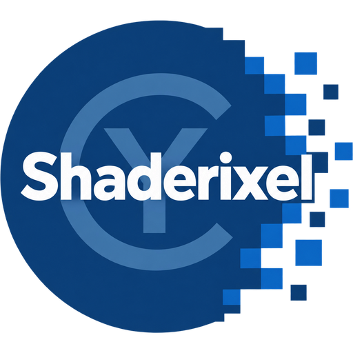
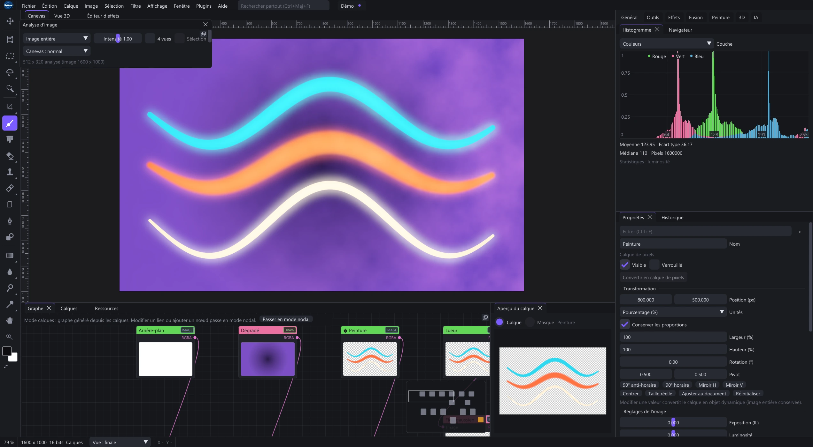
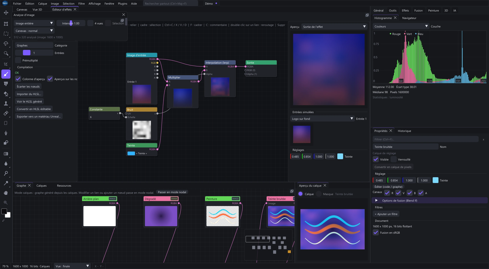
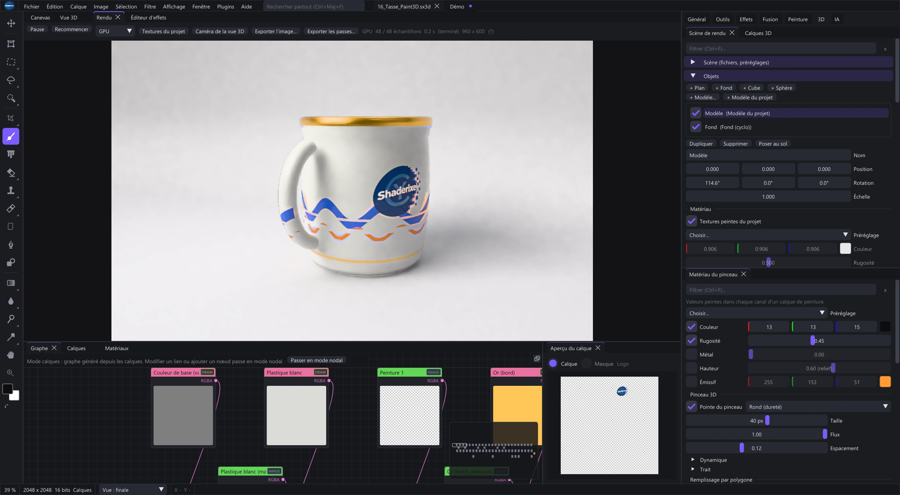
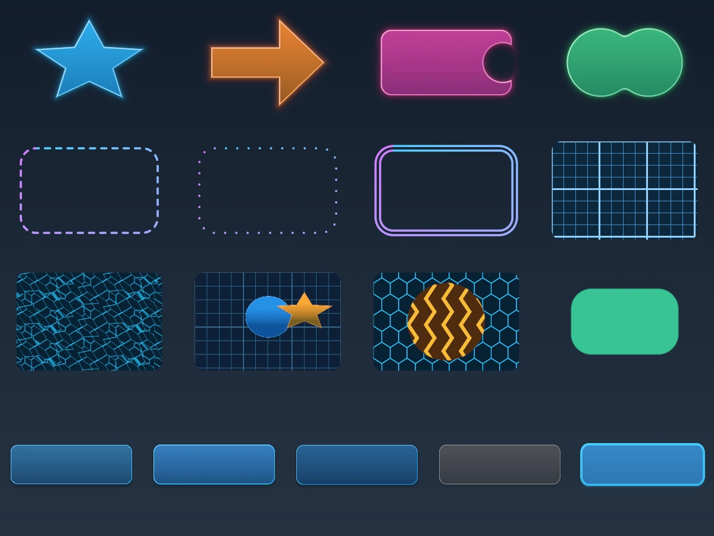

<table width="100%">
  <tr>
    <td width="300" align="left" valign="top">
      <a href="https://mrmybal.github.io/Shaderixel/?lang=fr">Présentation</a><br>
      <a href="https://mrmybal.github.io/Shaderixel/Documentation.html#/fr/getting-started">Documentation</a><br>
      <a href="https://github.com/MrMybal/Shaderixel">Dépôt</a><br><br>
      <sub>README</sub><br>
      <a href="README.md">English</a> · <a href="README.fr.md">Français</a>
    </td>
    <td width="400" align="center" valign="middle">
      <a href="https://mrmybal.github.io/Shaderixel/?lang=fr"></a>
    </td>
    <td width="300" align="right" valign="top">
      <p><sub>Licence de l’application</sub><br><a href="LICENSE"><strong>GPL-3.0-or-later</strong></a></p>
      <p><sub>Version</sub><br><a href="VERSION.fr.md"><strong>0.1.0-alpha.20261106</strong></a><br><strong>ALPHA</strong></p>
      <p><a href="https://github.com/MrMybal/Shaderixel/releases/download/v0.1.0-alpha.20261106/Shaderixel-0.1.0-alpha.20261106-windows-x64-setup.exe"><strong>Télécharger l’alpha</strong></a><br><sub>Windows x64 · installeur</sub></p>
    </td>
  </tr>
</table>

<h1 align="center">Shaderixel</h1>

Shaderixel est un éditeur d’images sur GPU pour les artistes, les créateurs de
textures et les profils techniques. Peignez et composez avec des calques
modifiables, assemblez des traitements dans un graphe ou créez vos propres effets
HLSL/Slang. La peinture 3D et les outils PBR prolongent ce travail de l’image
jusqu’à une matière appliquée sur un maillage.

> **ALPHA · 0.1.0-alpha.20261106**
>
> Une version expérimentale destinée aux essais et aux retours. Les fonctions et
> les formats de projet peuvent évoluer. Conservez des copies modifiables de vos
> travaux importants et consultez les [notes de version et limites documentées](VERSION.fr.md).

[](website/media/layers-fr.webp)

## À propos de Shaderixel

### Composer par calques, traiter avec des nœuds

Combinez peinture, texte, formes, masques, groupes, écrêtage et modes de fusion
dans une pile de calques. Les filtres et réglages restent modifiables.
**Convertir en calque de pixels** convertit le contenu rendu et ses filtres en pixels
sur lesquels peindre ; **Ctrl+Z** restaure le calque modifiable d’origine.

Le graphe image principal relie des opérations complètes et des fonctions
réutilisables. Le graphe d’effet, distinct, décrit le calcul par pixel à
l’intérieur d’un effet. Utilisez ses nœuds visuels ou l’éditeur HLSL/Slang pour
créer des filtres, des générateurs Draw et des fusions avec leurs propres réglages.

[](website/media/effect-lab-fr.webp)

### Travailler les textures et les matières

Peignez les canaux de matière sur un maillage, organisez remplissages et masques,
dépliez les UV et calculez des cartes depuis la géométrie. Inspectez couleur de
base, rugosité, métallicité, normales et autres canaux avant d’exporter un jeu de
textures PBR. Les outils photo-vers-PBR estiment les cartes depuis une image ;
ils ne mesurent pas la surface d’origine.

[](website/media/material-fr.webp)

### Créer des textures d’interface

Les bibliothèques UI UV et UI Toolkit proposent panneaux à neuf zones avec centre
répété, bordures à huit zones, atlas, jauges, formes SDF, motifs, traitements
d’alpha et états d’habillage explicites. Ajoutez les fonctions depuis le menu des
nœuds, sous **Bibliothèque > UI UV ...** ou **UI Toolkit ...**. Ouvrez la
[démo UI UV](examples/ui_uv_library_demo.sxl) ou la
[démo UI Toolkit](examples/ui_toolkit_demo.sxl) par **Fichier > Ouvrir**, ou
déposez-la sur le canevas. Utilisez un **document flottant 32 bits** pour les UV
et champs de distance signée. Consultez le
[guide des textures UI](https://mrmybal.github.io/Shaderixel/Documentation.html#/fr/ui-textures).

[](website/media/ui-toolkit.webp)

## Fonctionnalités

- **Peinture et composition** : pinceaux, retouche, sélections, masques, texte,
  formes, styles de calque et effets d’image modifiables.
- **Réglages précis** : double-cliquez ou faites Ctrl+clic sur un curseur numérique
  pour saisir une valeur. Dimensions en pixels, en pourcentage et avec des
  décimales ; point et virgule sont acceptés.
- **Couleur et développement photo** : exposition, balance des blancs, courbes,
  LUT, histogrammes et Photo RAW, selon les décodeurs et profils disponibles.
- **Peinture 3D et PBR** : calques de matière, matériaux intelligents, outils UV,
  calcul de cartes et export de textures. Le connecteur Unreal permet
  l’aller-retour des textures avec un éditeur Unreal compatible.
- **Animation par images** : séquences d’états de calques, durées, pelures d’oignon
  et export GIF ou MP4. Le contenu des calques est partagé ; les poses distinctes
  demandent des calques séparés ou des objets dynamiques indépendants.
- **Traitements réutilisables** : fonctions, variables exposées, actions,
  traitement par lots et graphes outils déclenchés par événements explicites.
- **Parcours IA optionnels** : fournisseurs configurés et traitements ComfyUI
  externes pour l’image, l’agrandissement, la profondeur ou les cartes PBR.
  Un preset n’installe ni serveur, ni modèle, ni nœud supplémentaire.
- **Extensions** : plugins natifs ou scriptés et interfaces publiques C/Python.

### Documentation et langues

[Ouvrir le manuel français](https://mrmybal.github.io/Shaderixel/Documentation.html#/fr/getting-started)
ou [le lire en anglais](https://mrmybal.github.io/Shaderixel/Documentation.html#/en/getting-started).
Le lecteur CyDoc comprend navigation, recherche, illustrations, schémas,
références des presets et API, ainsi que des graphes de fonctions interactifs.
**Ctrl+K** ouvre la recherche. Les images s’agrandissent dans la fenêtre du
lecteur ; **Échap** ferme l’agrandissement.

**Aide > Documentation** et **F1** ouvrent le fichier embarqué
`Documentation/Documentation.html` par une URL locale `file://`, avec une aide
adaptée à l’éditeur ou à la ressource sélectionnée. Conservez le répertoire
`Documentation/` complet à côté de l’exécutable. La lecture ne demande ni serveur,
ni connexion Internet, ni Node.js. **Aide > Projets d’exercice** ouvre les exemples
modifiables fournis.

Une installation neuve démarre en **anglais**. Changez la langue depuis
**Affichage > Langue** ; les préférences déjà enregistrées sont conservées.

---

## Installation

### Windows x64

Windows 10 version 2004 ou ultérieure est requis. Utilisez un GPU et un pilote
compatibles Direct3D 12 pour `Shaderixel.exe`, ou Vulkan pour `ShaderixelVk.exe`.
Aucun paquet macOS ou Linux n’est actuellement publié.

1. [Télécharger l’installeur alpha](https://github.com/MrMybal/Shaderixel/releases/download/v0.1.0-alpha.20261106/Shaderixel-0.1.0-alpha.20261106-windows-x64-setup.exe).
2. Lancez l’assistant d’installation. Il installe pour votre compte Windows, sans
   droits administrateur, et ajoute les raccourcis D3D12/Vulkan au menu Démarrer.
3. Lancez Shaderixel et ouvrez une image ou l’un des exemples fournis.

Le dossier proposé est `%LOCALAPPDATA%\Programs\Shaderixel Alpha`, avec un
raccourci de bureau optionnel. Bibliothèques d’exécution, effets, fonctions,
exemples, documentation hors ligne et notices de licence sont inclus.
L’installeur démarre en anglais et propose aussi le français.

Vous pouvez également [télécharger le ZIP portable](https://github.com/MrMybal/Shaderixel/releases/download/v0.1.0-alpha.20261106/Shaderixel-0.1.0-alpha.20261106-windows-x64.zip),
l’extraire intégralement dans un dossier accessible en écriture et lancer l’un
des deux exécutables. Conservez les répertoires fournis ensemble.
Les [notes de publication et fichiers SHA-256](https://github.com/MrMybal/Shaderixel/releases/tag/v0.1.0-alpha.20261106)
accompagnent les deux téléchargements. La désinstallation passe par
**Paramètres Windows > Applications** ; fichiers personnels et réglages sont conservés.

### Mises à jour

Shaderixel peut rechercher les versions GitHub au démarrage. Ouvrez
**Aide > Rechercher des mises à jour...** pour lancer une recherche, régler cette
préférence ou inclure les versions alpha. L’application vérifie taille et SHA-256
avant de proposer **Installer et redémarrer**. Les documents modifiés passent par
les choix d’enregistrement, d’abandon ou d’annulation. Une recherche échouée hors
ligne peut être relancée.

Le premier installeur du 2026-11-03 n’a pas de système de mise à jour. Installez
manuellement une alpha plus récente une fois pour activer les recherches suivantes.
Le canal public ne demande aucun compte GitHub.

## Sources, compilation et bibliothèques nécessaires

<details>
<summary>Compiler Shaderixel sous Windows</summary>

Utilisez Visual Studio 2022 avec les outils C++ pour applications de bureau,
le SDK Windows, CMake 3.24+ et Ninja, ainsi que Git, Python 3.9+, Node.js 22+ et npm.
Node/npm génèrent le manuel CyDoc pendant le développement ; ils ne sont pas
nécessaires pour le lire ou lancer l’éditeur. La compilation demande l’accès
au dépôt CyUI verrouillé par le projet.

```bat
git clone https://github.com/MrMybal/Shaderixel.git
cd Shaderixel
git clone -b docking https://github.com/ocornut/imgui external/imgui
git clone https://github.com/nothings/stb external/stb
git clone --depth 1 https://github.com/jpcy/xatlas external/xatlas
git clone --depth 1 https://github.com/ufbx/ufbx external/ufbx
python tools/fetch_cyui.py
python .CyDocBuild/build_manual.py --bootstrap
```

Extrayez un [SDK Slang pour Windows x64](https://github.com/shader-slang/slang/releases)
dans `external/slang`, en conservant `bin/`, `lib/` et `include/`.
La compilation copie les DLL DXC depuis le SDK Windows installé.

```bat
build.bat
build\Release\Shaderixel.exe
```

`build.bat` utilise Release par défaut ; `build.bat Debug` crée une compilation
Debug. `build_target.bat <target>` compile une seule cible. CMake applique les
correctifs ImGui et copie les dictionnaires ainsi que le lecteur CyDoc complet.
Les révisions sont fixées dans [cmake/dependencies.json](cmake/dependencies.json).

Décodeur RAW optionnel :

```bat
git clone --depth 1 --branch 0.22.2 https://github.com/LibRaw/LibRaw external/LibRaw
```

Pour l’exécutable Vulkan, ajoutez ces deux dépendances puis recompilez :

```bat
git clone --depth 1 https://github.com/KhronosGroup/Vulkan-Headers external/vulkan-headers
git clone --depth 1 https://github.com/zeux/volk external/volk
build.bat
build\Release\ShaderixelVk.exe
```

Le SDK Vulkan n’est pas requis ; l’exécution demande un pilote compatible.
Les profils XML Lensfun sont fournis séparément. Placez-les dans
`%LOCALAPPDATA%\Shaderixel\lensfun`, ou choisissez leur dossier dans l’application.

Pour créer un installeur, installez [Inno Setup 7](https://jrsoftware.org/isdl.php)
et utilisez un nom de paquet et de version encore inutilisé :

```bat
python tools/package.py --source-only-unreal --name Shaderixel-0.1.0-alpha.20261106-windows-x64
python tools/build_installer.py --package dist/Shaderixel-0.1.0-alpha.20261106-windows-x64 --version 0.1.0-alpha.20261106
```

Ajoutez `--iscc <chemin-vers-ISCC.exe>` si Inno Setup n’est pas détecté.
L’outil recompile les deux moteurs graphiques et produit un EXE et son fichier
SHA-256 dans `dist/`. Le plugin Unreal est fourni sous forme de sources à compiler
pour le moteur visé ; consultez son [README](unreal/ShaderixelLink/README.md).

</details>

---

## Licence

Copyright (c) 2026 MrMybal and Shaderixel contributors.

**Shaderixel utilise la [GNU GPL version 3 ou ultérieure](LICENSE)
(`GPL-3.0-or-later`).** Il est distribué sans garantie ; les conditions complètes
figurent dans la licence. Utiliser Shaderixel ne place pas, à lui seul, vos
images, textures ou modèles sous GPL.

Le [connecteur Unreal autonome](unreal/ShaderixelLink/README.md) utilise une
[licence MIT distincte](unreal/ShaderixelLink/LICENSE). Il communique avec
Shaderixel par fichiers et processus séparé. Unreal Engine reste soumis aux
conditions d’Epic.

### Bibliothèques de l’application

| Bibliothèque · sources | Licence · texte | Utilisation / périmètre |
| --- | --- | --- |
| [CyUI](https://github.com/MrMybal/CyUI) | [MIT](https://github.com/MrMybal/CyUI/blob/8367401fe45fc22bfed5e227cb3de343177f676b/LICENSE) | Modules natifs sélectionnés ; l’accès aux sources demande une autorisation sur le dépôt. Licence livrée dans `licences/cyui/LICENSE`. |
| [Dear ImGui](https://github.com/ocornut/imgui) | [MIT](https://github.com/ocornut/imgui/blob/docking/LICENSE.txt) | Interface native et intégration Windows, avec les correctifs de Shaderixel. |
| [ImGuiColorTextEdit](https://github.com/goossens/ImGuiColorTextEdit) | [MIT et notices CyUI](https://github.com/MrMybal/CyUI/blob/8367401fe45fc22bfed5e227cb3de343177f676b/THIRD_PARTY_NOTICES.md) | Éditeur de source via CyUI CodeEditor ; notice sous `licences/cyui/third_party/texteditor/`. |
| [Lexilla](https://github.com/ScintillaOrg/lexilla), [Scintilla](https://github.com/mirror/scintilla) et [SciTE](https://github.com/mirror/scite) | [Conditions permissives de type HPND et notices](https://github.com/MrMybal/CyUI/blob/8367401fe45fc22bfed5e227cb3de343177f676b/THIRD_PARTY_NOTICES.md) | Analyseurs sélectionnés, en-têtes publics et mots-clés via CyUI ; aucune interface d’éditeur Scintilla n’est liée. |
| [Slang](https://github.com/shader-slang/slang) | [Apache-2.0 WITH LLVM-exception](https://github.com/shader-slang/slang/blob/master/LICENSE), avec notices des composants | Compilation des shaders à l’exécution et DLL associées ; conserver `licences/slang_LICENSES/`. |
| [DirectX Shader Compiler](https://github.com/microsoft/DirectXShaderCompiler) | [Licence et notices des composants](https://github.com/microsoft/DirectXShaderCompiler/blob/main/LICENSE.TXT) | Compilation des shaders ; DLL DXC/DXIL issues du SDK Windows, dont les conditions de redistribution s’appliquent aussi. |
| [stb](https://github.com/nothings/stb) | [MIT ou domaine public / Unlicense](https://github.com/nothings/stb/blob/master/LICENSE) | Utilitaires d’images et de polices, avec notices dans les sources fournies. |
| [xatlas](https://github.com/jpcy/xatlas) | [MIT](https://github.com/jpcy/xatlas/blob/master/LICENSE) | Dépliage UV automatique natif. |
| [ufbx](https://github.com/ufbx/ufbx) | [MIT ou domaine public / Unlicense](https://github.com/ufbx/ufbx/blob/master/LICENSE) | Chargement FBX natif. |
| [LibRaw](https://github.com/LibRaw/LibRaw) | [LGPL-2.1 ou CDDL-1.0, avec notices des composants](https://github.com/LibRaw/LibRaw/blob/0.22.2/COPYRIGHT) | Décodeur RAW optionnel à la compilation ; conserver les deux licences et `COPYRIGHT`. |
| [volk](https://github.com/zeux/volk) | [MIT](https://github.com/zeux/volk/blob/master/LICENSE.md) | Chargeur optionnel pour le moteur Vulkan. |
| [Vulkan-Headers](https://github.com/KhronosGroup/Vulkan-Headers) | [Apache-2.0 / MIT selon les fichiers](https://github.com/KhronosGroup/Vulkan-Headers/blob/main/LICENSE.md) | En-têtes de compilation Vulkan. |
| [Microsoft Visual C++ Runtime](https://learn.microsoft.com/cpp/windows/redistributing-visual-cpp-files) | [Conditions de redistribution Microsoft](https://visualstudio.microsoft.com/license-terms/) | Bibliothèques d’exécution incluses par l’outil de création d’installeur. |
| [Profils Lensfun](https://github.com/lensfun/lensfun) | [CC BY-SA 3.0](https://github.com/lensfun/lensfun/blob/master/data/COPYING.CC_BY-SA_3.0) | Base XML externe optionnelle pour les objectifs ; non livrée. |

### Documentation et outils de compilation

| Bibliothèque · sources | Licence · texte | Utilisation / périmètre |
| --- | --- | --- |
| [CyDoc](https://github.com/MrMybal/CyDoc) | [MIT](https://github.com/MrMybal/CyDoc/blob/6ddf9a582defb2f11fbb3f992afef6f98dcadc93/LICENSE) | Lecteur hors ligne embarqué ; modules image, gallery et graph. Aucun lecteur de maillage ni Three.js n’est nécessaire. |
| [marked](https://github.com/markedjs/marked) | [MIT](https://github.com/markedjs/marked/blob/v17.0.1/LICENSE.md) | Compilation Markdown à la génération documentaire. |
| [PrismJS](https://github.com/PrismJS/prism) | [MIT](https://github.com/PrismJS/prism/blob/v1.30.0/LICENSE) | Coloration du code à la génération. |
| [esbuild](https://github.com/evanw/esbuild) | [MIT](https://github.com/evanw/esbuild/blob/v0.25.12/LICENSE.md) | Assemblage documentaire pendant la compilation. |

Ces tableaux recensent les principaux composants ; ils ne remplacent pas les
notices tierces complètes. Conservez le répertoire `licences/`, les notices CyUI
et les licences des composants de Slang. Outils optionnels et services externes
gardent leurs propres conditions.

## Références et liens

- [Manuel français](https://mrmybal.github.io/Shaderixel/Documentation.html#/fr/getting-started) · [Manuel anglais](https://mrmybal.github.io/Shaderixel/Documentation.html#/en/getting-started).
- [Présentation du logiciel](https://mrmybal.github.io/Shaderixel/?lang=fr) · [English website](https://mrmybal.github.io/Shaderixel/).
- [Notes de version et limites](VERSION.fr.md) · [Versions publiées](https://github.com/MrMybal/Shaderixel/releases).
- [Dépôt des sources](https://github.com/MrMybal/Shaderixel) · [Suivi des problèmes](https://github.com/MrMybal/Shaderixel/issues).
- [Architecture](docs/ARCHITECTURE.md) · [Intégration CyUI](docs/CYUI_MIGRATION.md) · [Feuille de route](docs/ROADMAP.md).
