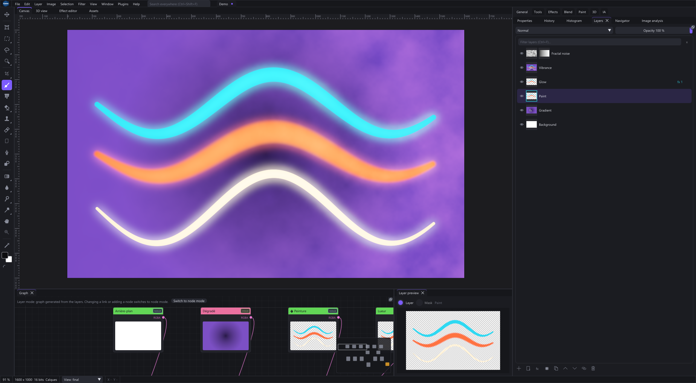
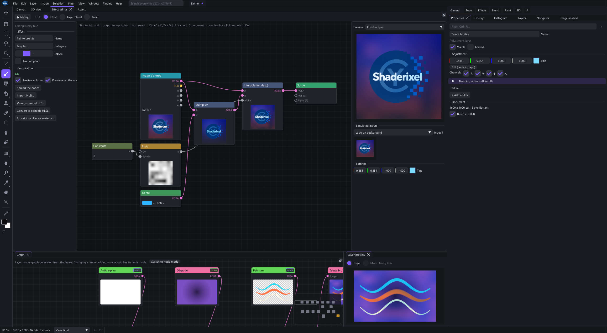
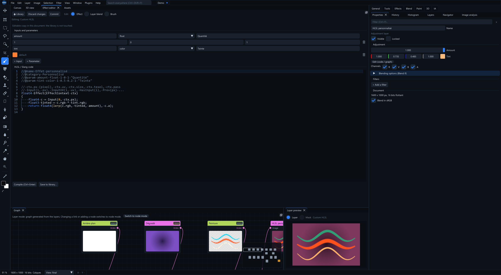

# Shaderixel

GPU image editor with a Photoshop-style **layer** workflow and a **node graph**
workflow. Effects are written in HLSL/Slang and compiled at runtime.

## Install (Windows x64)

[Download the alpha installer](https://github.com/MrMybal/Shaderixel/releases/download/v0.1.0-alpha.20261103/Shaderixel-0.1.0-alpha.20261103-windows-x64-setup.exe)
and run it. Windows 10 version 2004 or later and a D3D12-capable GPU are required;
the Vulkan executable requires a compatible Vulkan driver.

The installer defaults to `%LOCALAPPDATA%\Programs\Shaderixel Alpha` and does not
require administrator rights. It adds Start menu shortcuts for D3D12 and Vulkan,
with an optional desktop shortcut. Visual C++ runtime libraries, effects, graph
functions, examples and license notices are included. The installer interface
starts in English; French is also available.

Uninstall from **Windows Settings > Apps**. User-created files and settings are
retained. The portable ZIP remains available on the
[release page](https://github.com/MrMybal/Shaderixel/releases/tag/v0.1.0-alpha.20261103).

## Screenshots

**Layers and non-destructive effects** — combine painting, gradients, masks and
adjustments, with the layer stack and generated graph visible together.



**Visual effect graphs** — connect image inputs, math operations and parameters,
with live node thumbnails and an effect-output preview.



**HLSL/Slang editing** — edit shader code with syntax highlighting and expose
parameters in the same workspace as the graph and layer preview.



## Interface language

The interface defaults to **English** on a fresh installation. Select another
language from **View > Language**; existing language preferences are preserved.
Interface dictionaries are loaded from `lang/` next to the executable, or from
`library/lang/` when running a development build. An unavailable saved language
falls back to English.

## Build (Windows, Visual Studio 2022)

```bat
python tools/fetch_cyui.py
build.bat            (Release)
build.bat Debug
```

The Release executables are generated in `build/Release/`: `Shaderixel.exe`
(D3D12) and, when the Vulkan headers are available, `ShaderixelVk.exe` (Vulkan).
Use `build_target.bat <target>` to build a single target. The build copies the
interface dictionaries into `lang/` alongside the executables.

## Build the Windows installer

Install [Inno Setup 7](https://jrsoftware.org/isdl.php), then generate the example
package and compile the setup executable with the Visual Studio x64 CRT:

```bat
python tools/package.py --source-only-unreal --name Shaderixel-0.1.0-alpha.20261103-windows-x64
python tools/build_installer.py --package dist/Shaderixel-0.1.0-alpha.20261103-windows-x64 --version 0.1.0-alpha.20261103 --iscc "C:\Program Files\Inno Setup 7\ISCC.exe"
```

Use a fresh version/package name for each build. The installer tool rebuilds both
executables, stages selected package content and writes a setup EXE plus a SHA-256
sidecar to `dist/`. Use `--crt-dir` to select another Visual Studio x64
`Microsoft.VC143.CRT` redistributable directory. Machine-dependent demo guide
captures and runtime caches are excluded; the reviewed README screenshots are included.

`python tools/test_installer.py --installer <setup.exe> --manifest <manifest.json>`
checks installation, reinstall, both installed executables and uninstall while
preserving a user-created file. The manifest is generated under
`build/InstallerPayload/<version>/manifest.json`. The check refuses to replace an
existing Shaderixel Alpha registration and uses silent installers and internal
application demos without operating system input devices.

## Dependencies (`external/`, not tracked by Git)

- CyUI 1.2, locked to `8367401fe45fc22bfed5e227cb3de343177f676b`: run `python tools/fetch_cyui.py`. The build uses the application's existing ImGui target and only Core, Canvas, Nodes, Curves, Plots, Images, Code and CodeEditor.
- Dear ImGui, docking branch: `git clone -b docking https://github.com/ocornut/imgui external/imgui`
- stb: `git clone https://github.com/nothings/stb external/stb`
- xatlas (automatic UV unwrapping, MIT): `git clone --depth 1 https://github.com/jpcy/xatlas external/xatlas`
- ufbx (FBX loading, MIT): `git clone --depth 1 https://github.com/ufbx/ufbx external/ufbx`
- LibRaw (camera RAW decoding, LGPL 2.1 / CDDL 1.0, optional; WIC is used when unavailable): `git clone --depth 1 --branch 0.22.2 https://github.com/LibRaw/LibRaw external/LibRaw`
- Lens profiles: the [lensfun](https://github.com/lensfun/lensfun) database (`data/db`, CC BY-SA 3.0) is not bundled. Place its XML files in `%LOCALAPPDATA%\Shaderixel\lensfun` or select a folder in the application. Installed darktable and RawTherapee databases are also detected.
- Unreal textures (`.uasset`) are read by `src/io/uasset`, adapted from CyImgView by the same author. Meshes stored in `.uasset` files are exported through an installed Unreal Editor using a commandlet and glTF.
- Slang: extract the Windows x64 release into `external/slang`.
- DXC (`dxcompiler.dll` / `dxil.dll`): copied automatically from the Windows SDK.
- Vulkan (optional): `git clone --depth 1 https://github.com/KhronosGroup/Vulkan-Headers external/vulkan-headers`
  and `git clone --depth 1 https://github.com/zeux/volk external/volk`. No Vulkan SDK is required; a compatible driver is needed at runtime.

## UI integration checks

Run `tools\test_cyui.bat` (or add `--clean` for a complete rebuild) to configure a separate `build/CyUiCheck` directory,
build both Windows backends and run the headless UI interaction tests. Tests feed
ImGui events directly and never operate the system mouse or keyboard. Run
`python tools/test_cyui_native.py` for native GPU captures and effect compilation. Audio,
Gallery, the CyUI demo, Web/CEF and the optional ImGuizmo adapter are disabled.
See [docs/CYUI_MIGRATION.md](docs/CYUI_MIGRATION.md) for the integration boundary,
retained application adapters and verification details.

See also [docs/ARCHITECTURE.md](docs/ARCHITECTURE.md),
[docs/ROADMAP.md](docs/ROADMAP.md) and the
[Unreal Engine plugin README](unreal/ShaderixelLink/README.md).

## License

Copyright (c) 2026 MrMybal and Shaderixel contributors.

Except where a separate license is specified, Shaderixel is free software:
you can redistribute it and/or modify it under the terms of the GNU General
Public License as published by the Free Software Foundation, either version 3
of the License, or (at your option) any later version (`GPL-3.0-or-later`).
See [LICENSE](LICENSE) for the full terms.

Shaderixel is distributed in the hope that it will be useful, but WITHOUT ANY
WARRANTY; without even the implied warranty of MERCHANTABILITY or FITNESS FOR
A PARTICULAR PURPOSE.

The standalone Unreal Engine connector in `unreal/ShaderixelLink/` is separately
licensed under the [MIT License](unreal/ShaderixelLink/LICENSE). It communicates
with Shaderixel through files and a separate process. This license does not
cover Unreal Engine itself, which remains subject to Epic's terms.

[CyUI](https://github.com/MrMybal/CyUI) is licensed under the
[MIT License](https://github.com/MrMybal/CyUI/blob/8367401fe45fc22bfed5e227cb3de343177f676b/LICENSE).
Its repository is currently private, so viewing that link requires repository access.
Distributions include the license text at `licences/cyui/LICENSE`, together with
notices for the selected CyUI modules and their dependencies.

Third-party dependencies retain their own licenses and copyright notices.
Using Shaderixel does not, by itself, place your images, textures or models
under the GPL.
