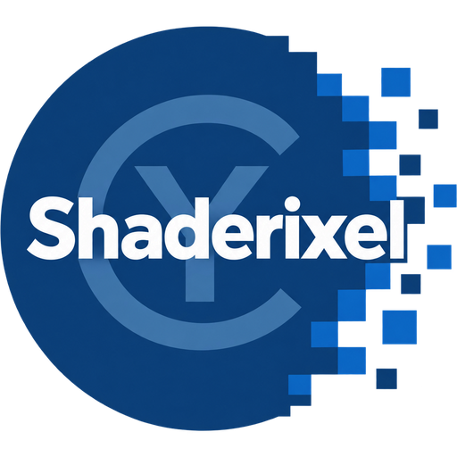
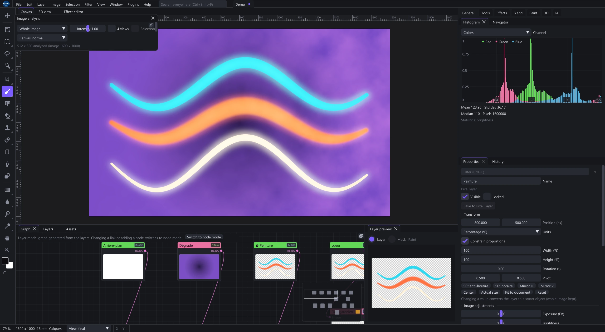
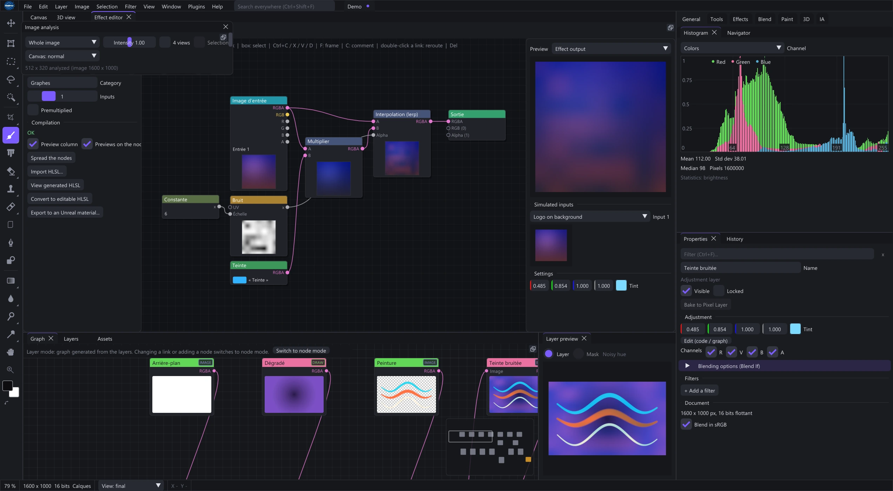
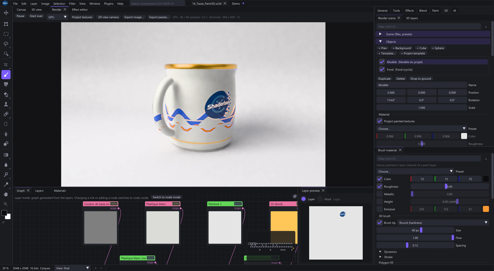
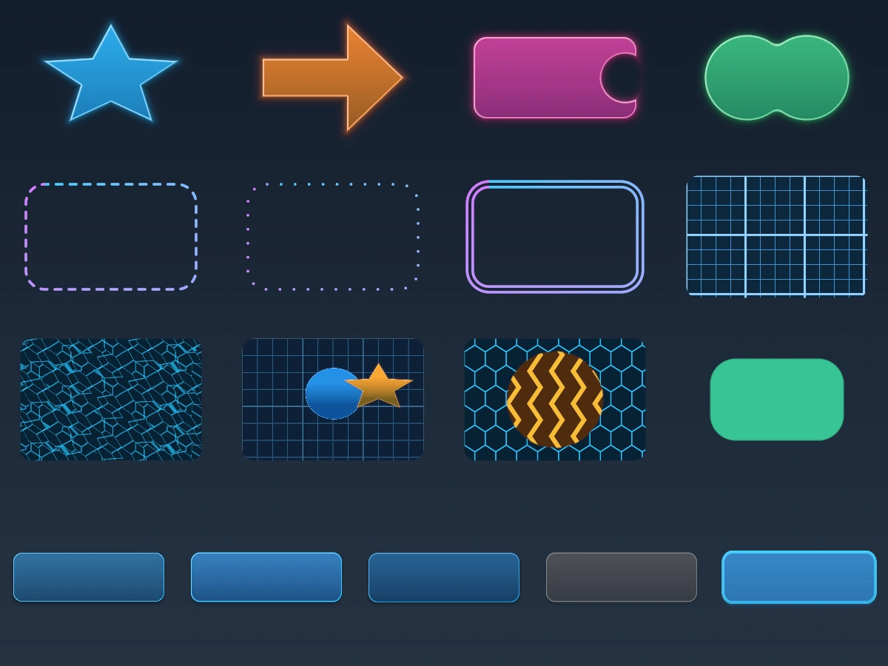

<table width="100%">
  <tr>
    <td width="300" align="left" valign="top">
      <a href="https://mrmybal.github.io/Shaderixel/">Website</a><br>
      <a href="https://mrmybal.github.io/Shaderixel/Documentation.html#/en/getting-started">Documentation</a><br>
      <a href="https://github.com/MrMybal/Shaderixel">Repository</a><br><br>
      <sub>README</sub><br>
      <a href="README.md">English</a> · <a href="README.fr.md">Français</a>
    </td>
    <td width="400" align="center" valign="middle">
      <a href="https://mrmybal.github.io/Shaderixel/"></a>
    </td>
    <td width="300" align="right" valign="top">
      <p><sub>Application license</sub><br><a href="LICENSE"><strong>GPL-3.0-or-later</strong></a></p>
      <p><sub>Version</sub><br><a href="VERSION.md"><strong>0.1.0-alpha.20261106</strong></a><br><strong>ALPHA</strong></p>
      <p><a href="https://github.com/MrMybal/Shaderixel/releases/download/v0.1.0-alpha.20261106/Shaderixel-0.1.0-alpha.20261106-windows-x64-setup.exe"><strong>Download the alpha</strong></a><br><sub>Windows x64 · installer</sub></p>
    </td>
  </tr>
</table>

<h1 align="center">Shaderixel</h1>

Shaderixel is a GPU image editor for artists, texture makers and technical
creators. Paint and composite with editable layers, assemble image operations
in a node graph, or create your own HLSL/Slang effects. Paint 3D and PBR tools
extend the workflow from an image to a material on a mesh.

> **ALPHA · 0.1.0-alpha.20261106**
>
> An experimental release for testing and feedback. Features and project formats
> may change. Keep editable copies of important work and read the
> [version notes and documented limitations](VERSION.md).

[](website/media/layers-en.webp)

## About Shaderixel

### Compose in layers, process with nodes

Combine painting, text, shapes, masks, groups, clipping and blend modes in a layer
stack. Filters and adjustments remain editable. **Bake to Pixel Layer** turns
rendered content and its filters into paintable pixels; **Ctrl+Z** restores the
original editable layer.

The main image graph connects complete image operations and reusable functions.
The separate effect graph describes the per-pixel calculation inside one effect.
Use visual nodes or the HLSL/Slang source editor to create filters, Draw
generators and blends with exposed controls.

[](website/media/effect-lab-en.webp)

### Work on textures and materials

Paint material channels on a mesh, organize fills and masks, unwrap UVs and bake
mesh maps. Inspect base color, roughness, metalness, normals and other channels
before exporting a PBR texture set. Photo-to-PBR tools estimate maps from an
image; they do not measure the original surface.

[](website/media/material-en.webp)

### Build interface textures

The UI UV and UI Toolkit libraries provide nine-slice panels with repeating
centers, eight-slice borders, atlases, progress indicators, SDF shapes, patterns,
alpha processing and explicit skin states. Add functions from the graph node
menu under **Library > UI UV ...** or **UI Toolkit ...**. Open the
[UI UV demo](examples/ui_uv_library_demo.sxl) or
[UI Toolkit demo](examples/ui_toolkit_demo.sxl) with **File > Open**, or drop it
on the canvas. Use a **32-bit float document** for UV and signed-distance fields.
See the [UI texture guide](https://mrmybal.github.io/Shaderixel/Documentation.html#/en/ui-textures).

[](website/media/ui-toolkit.webp)

## Features

- **Painting and compositing:** brushes, retouching, selections, masks, text,
  shapes, layer styles and editable image effects.
- **Precise controls:** double-click or Ctrl+click numeric sliders to type a
  value. Layer and shape dimensions support pixels, percentages and decimals;
  numeric input accepts a decimal dot or comma.
- **Color and photo development:** exposure, white balance, curves, LUTs,
  histograms and Photo RAW controls, subject to available decoders and profiles.
- **Paint 3D and PBR:** material layers, smart materials, UV tools, mesh baking
  and texture-set export. The Unreal connector supports texture round trips
  with a compatible Unreal Editor.
- **Frame animation:** layer-state sequences, durations, onion skins and GIF
  or MP4 export. Frames share layer content; separate poses need separate
  layers or independent smart objects.
- **Reusable workflows:** functions, exposed variables, actions, batch processing
  and graph tools with explicit execution events.
- **Optional AI workflows:** configured providers and external ComfyUI workflows
  for image processing, upscaling, depth and PBR maps. Servers, models and custom
  nodes are not installed by a preset.
- **Extensions:** native/script plugins and public C/Python interfaces.

### Documentation and languages

[Open the English manual](https://mrmybal.github.io/Shaderixel/Documentation.html#/en/getting-started)
or [read it in French](https://mrmybal.github.io/Shaderixel/Documentation.html#/fr/getting-started).
The CyDoc reader includes navigation, search, illustrations, diagrams, preset/API
references and interactive saved function graphs. **Ctrl+K** opens search.
Images enlarge inside the reader window; **Escape** closes the enlargement.

**Help > Documentation** and **F1** open the bundled
`Documentation/Documentation.html` through a local `file://` URL, with contextual
help for the selected editor or resource. Keep the complete `Documentation/`
directory beside the executable. Reading needs no server, Internet connection
or Node.js. **Help > Practice projects** opens supplied editable examples.

The application starts in **English** on a fresh installation. Use
**View > Language** to change it; existing language preferences are preserved.

---

## Installation

### Windows x64

Windows 10 version 2004 or later is required. Use a GPU and driver compatible
with Direct3D 12 for `Shaderixel.exe`, or Vulkan for `ShaderixelVk.exe`.
No macOS or Linux package is currently published.

1. [Download the alpha installer](https://github.com/MrMybal/Shaderixel/releases/download/v0.1.0-alpha.20261106/Shaderixel-0.1.0-alpha.20261106-windows-x64-setup.exe).
2. Run the setup wizard. It installs for your Windows account, without
   administrator rights, and adds D3D12/Vulkan Start menu shortcuts.
3. Start Shaderixel and open an image or one of the supplied examples.

The installer defaults to `%LOCALAPPDATA%\Programs\Shaderixel Alpha`, with an
optional desktop shortcut. Runtime libraries, effects, graph functions, examples,
offline documentation and license notices are included. Its interface starts in
English, with French also available.

Alternatively, [download the portable ZIP](https://github.com/MrMybal/Shaderixel/releases/download/v0.1.0-alpha.20261106/Shaderixel-0.1.0-alpha.20261106-windows-x64.zip),
extract the complete archive into a writable folder and run either executable.
Keep the supplied directories together.
[Release notes and SHA-256 files](https://github.com/MrMybal/Shaderixel/releases/tag/v0.1.0-alpha.20261106)
accompany both downloads. Uninstall through **Windows Settings > Apps**;
user-created files and settings are retained.

### Updates

Shaderixel can check GitHub releases at startup. Open **Help > Check for
updates...** to check manually, change the startup preference or include alpha
releases. The application verifies size and SHA-256 before offering **Install
and restart**. Unsaved documents use the normal save/discard/cancel prompts.
Offline checks can be retried.

The first installer dated 2026-11-03 has no updater. Install a newer alpha manually
once to enable subsequent checks. The public update channel needs no GitHub account.

## Source, build and required libraries

<details>
<summary>Build Shaderixel on Windows</summary>

Use Visual Studio 2022 with the C++ desktop tools, Windows SDK, CMake 3.24+ and
Ninja, plus Git, Python 3.9+, Node.js 22+ and npm. Node/npm generate the CyDoc
manual during development; they are not needed to read it or run the editor.
Source builds require access to the pinned CyUI repository.

```bat
git clone https://github.com/MrMybal/Shaderixel.git
cd Shaderixel
git clone -b docking https://github.com/ocornut/imgui external/imgui
git clone https://github.com/nothings/stb external/stb
git clone --depth 1 https://github.com/jpcy/xatlas external/xatlas
git clone --depth 1 https://github.com/ufbx/ufbx external/ufbx
python tools/fetch_cyui.py
python .CyDocBuild/build_manual.py --bootstrap
```

Extract a Windows x64 [Slang SDK](https://github.com/shader-slang/slang/releases)
into `external/slang`, keeping its `bin/`, `lib/` and `include/` directories.
The build copies DXC DLLs from the installed Windows SDK.

```bat
build.bat
build\Release\Shaderixel.exe
```

`build.bat` defaults to Release; `build.bat Debug` creates a Debug build.
`build_target.bat <target>` builds one target. CMake applies Shaderixel's supplied
ImGui patches and stages language dictionaries and the complete CyDoc export.
Pinned revisions are recorded in [cmake/dependencies.json](cmake/dependencies.json).

Optional camera RAW decoding:

```bat
git clone --depth 1 --branch 0.22.2 https://github.com/LibRaw/LibRaw external/LibRaw
```

For the Vulkan executable, add both dependencies before rebuilding:

```bat
git clone --depth 1 https://github.com/KhronosGroup/Vulkan-Headers external/vulkan-headers
git clone --depth 1 https://github.com/zeux/volk external/volk
build.bat
build\Release\ShaderixelVk.exe
```

No Vulkan SDK is required; running that executable needs a compatible driver.
Lensfun XML profiles are supplied separately. Place them under
`%LOCALAPPDATA%\Shaderixel\lensfun`, or select their folder in the application.

To create an installer, install [Inno Setup 7](https://jrsoftware.org/isdl.php)
and use a fresh package/version name:

```bat
python tools/package.py --source-only-unreal --name Shaderixel-0.1.0-alpha.20261106-windows-x64
python tools/build_installer.py --package dist/Shaderixel-0.1.0-alpha.20261106-windows-x64 --version 0.1.0-alpha.20261106
```

Pass `--iscc <path-to-ISCC.exe>` if Inno Setup is not found automatically.
The installer tool rebuilds both backends and writes an EXE and SHA-256 sidecar
to `dist/`. The Unreal plugin is supplied as source to build for the target
engine version; see its [README](unreal/ShaderixelLink/README.md).

</details>

---

## License

Copyright (c) 2026 MrMybal and Shaderixel contributors.

**Shaderixel uses the [GNU GPL version 3 or later](LICENSE)
(`GPL-3.0-or-later`).** It is distributed without warranty; see the complete
license for its terms. Using Shaderixel does not, by itself, place your images,
textures or models under the GPL.

The standalone [Unreal connector](unreal/ShaderixelLink/README.md) uses a separate
[MIT license](unreal/ShaderixelLink/LICENSE). It communicates with Shaderixel
through files and a separate process. Unreal Engine remains subject to Epic's terms.

### Application libraries

| Library · source | License · terms | Use / scope |
| --- | --- | --- |
| [CyUI](https://github.com/MrMybal/CyUI) | [MIT](https://github.com/MrMybal/CyUI/blob/8367401fe45fc22bfed5e227cb3de343177f676b/LICENSE) | Selected native UI modules; source access requires repository permission. License included at `licences/cyui/LICENSE`. |
| [Dear ImGui](https://github.com/ocornut/imgui) | [MIT](https://github.com/ocornut/imgui/blob/docking/LICENSE.txt) | Native interface and Windows backend, with Shaderixel patches. |
| [ImGuiColorTextEdit](https://github.com/goossens/ImGuiColorTextEdit) | [MIT and CyUI notices](https://github.com/MrMybal/CyUI/blob/8367401fe45fc22bfed5e227cb3de343177f676b/THIRD_PARTY_NOTICES.md) | Source editor through CyUI CodeEditor; bundled notice under `licences/cyui/third_party/texteditor/`. |
| [Lexilla](https://github.com/ScintillaOrg/lexilla), [Scintilla](https://github.com/mirror/scintilla) and [SciTE](https://github.com/mirror/scite) | [HPND-style permissive terms and notices](https://github.com/MrMybal/CyUI/blob/8367401fe45fc22bfed5e227cb3de343177f676b/THIRD_PARTY_NOTICES.md) | Selected lexers, public headers and keyword data via CyUI; no Scintilla editor UI is linked. |
| [Slang](https://github.com/shader-slang/slang) | [Apache-2.0 WITH LLVM-exception](https://github.com/shader-slang/slang/blob/master/LICENSE), plus component notices | Runtime shader compiler and support DLLs; retain `licences/slang_LICENSES/`. |
| [DirectX Shader Compiler](https://github.com/microsoft/DirectXShaderCompiler) | [License and component notices](https://github.com/microsoft/DirectXShaderCompiler/blob/main/LICENSE.TXT) | Shader compilation; DXC/DXIL DLLs come from the Windows SDK. SDK redistribution terms also apply. |
| [stb](https://github.com/nothings/stb) | [MIT or public domain / Unlicense](https://github.com/nothings/stb/blob/master/LICENSE) | Image and font helpers, with notices in their supplied sources. |
| [xatlas](https://github.com/jpcy/xatlas) | [MIT](https://github.com/jpcy/xatlas/blob/master/LICENSE) | Native automatic UV unwrapping. |
| [ufbx](https://github.com/ufbx/ufbx) | [MIT or public domain / Unlicense](https://github.com/ufbx/ufbx/blob/master/LICENSE) | Native FBX loading. |
| [LibRaw](https://github.com/LibRaw/LibRaw) | [LGPL-2.1 or CDDL-1.0, plus component notices](https://github.com/LibRaw/LibRaw/blob/0.22.2/COPYRIGHT) | Optional camera RAW decoder at build time; retain both license texts and `COPYRIGHT`. |
| [volk](https://github.com/zeux/volk) | [MIT](https://github.com/zeux/volk/blob/master/LICENSE.md) | Optional Vulkan loader for the Vulkan backend. |
| [Vulkan-Headers](https://github.com/KhronosGroup/Vulkan-Headers) | [Apache-2.0 / MIT by file](https://github.com/KhronosGroup/Vulkan-Headers/blob/main/LICENSE.md) | Build-time Vulkan headers. |
| [Microsoft Visual C++ Runtime](https://learn.microsoft.com/cpp/windows/redistributing-visual-cpp-files) | [Microsoft redistribution terms](https://visualstudio.microsoft.com/license-terms/) | Runtime libraries included by the installer tool. |
| [Lensfun profile data](https://github.com/lensfun/lensfun) | [CC BY-SA 3.0](https://github.com/lensfun/lensfun/blob/master/data/COPYING.CC_BY-SA_3.0) | Optional external lens XML database; not bundled. |

### Documentation and build tools

| Library · source | License · terms | Use / scope |
| --- | --- | --- |
| [CyDoc](https://github.com/MrMybal/CyDoc) | [MIT](https://github.com/MrMybal/CyDoc/blob/6ddf9a582defb2f11fbb3f992afef6f98dcadc93/LICENSE) | Bundled offline reader; image, gallery and graph modules. No mesh viewer or Three.js is required. |
| [marked](https://github.com/markedjs/marked) | [MIT](https://github.com/markedjs/marked/blob/v17.0.1/LICENSE.md) | Build-time Markdown compilation. |
| [PrismJS](https://github.com/PrismJS/prism) | [MIT](https://github.com/PrismJS/prism/blob/v1.30.0/LICENSE) | Build-time code highlighting. |
| [esbuild](https://github.com/evanw/esbuild) | [MIT](https://github.com/evanw/esbuild/blob/v0.25.12/LICENSE.md) | Documentation bundling during builds. |

These tables index the main components; they do not replace complete third-party
notices. Keep the supplied `licences/` directory, CyUI's notices and Slang's
component licenses. Optional tools and external services retain their own terms.

## References and links

- [English manual](https://mrmybal.github.io/Shaderixel/Documentation.html#/en/getting-started) · [French manual](https://mrmybal.github.io/Shaderixel/Documentation.html#/fr/getting-started).
- [Product website](https://mrmybal.github.io/Shaderixel/) · [Présentation en français](https://mrmybal.github.io/Shaderixel/?lang=fr).
- [Version notes and limitations](VERSION.md) · [Published releases](https://github.com/MrMybal/Shaderixel/releases).
- [Source repository](https://github.com/MrMybal/Shaderixel) · [Issue tracker](https://github.com/MrMybal/Shaderixel/issues).
- [Architecture](docs/ARCHITECTURE.md) · [CyUI integration](docs/CYUI_MIGRATION.md) · [Roadmap](docs/ROADMAP.md).
