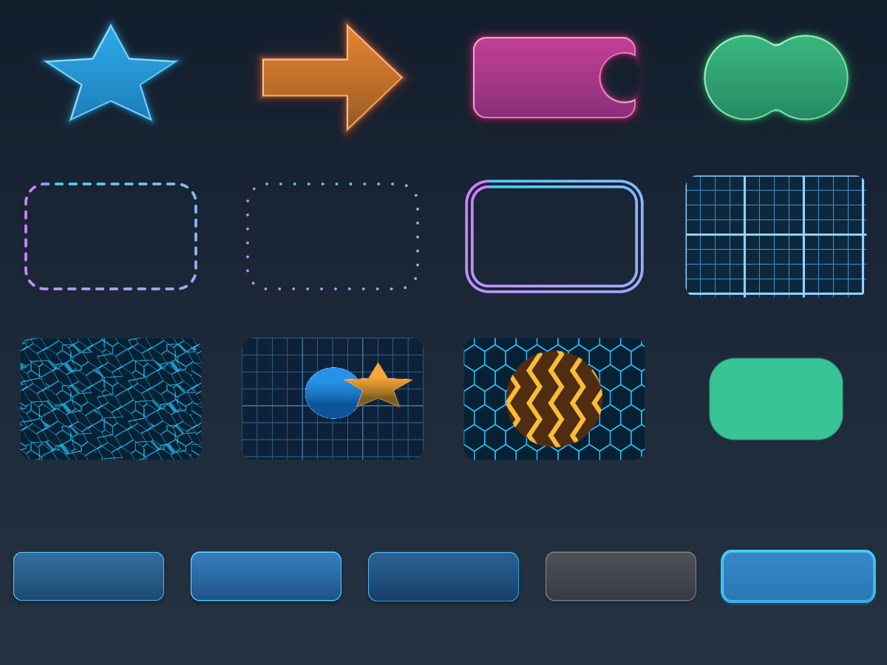
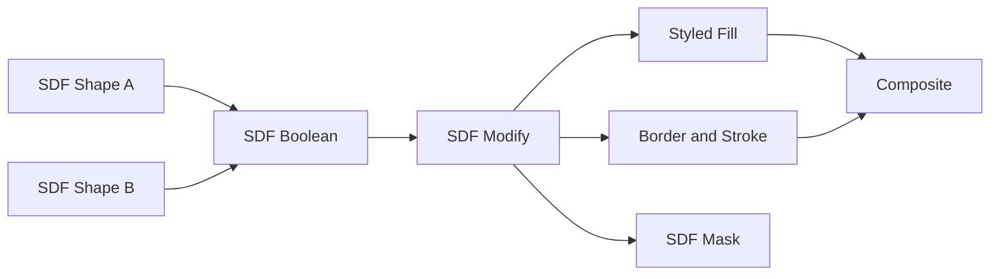

# UI Toolkit Library

**15 standalone shaders and 41 composed graphs** extend the UI UV library with all ten proposed families: SDF shapes, Boolean operations, borders/strokes, flow maps, parallax, transitions, interface patterns, pixel snapping, alpha cleanup and coordinated skin variants. Names, labels and graph descriptions are English. These are additions; the earlier UI UV files and application source are unchanged by this library.



Open [`examples/ui_toolkit_demo.sxl`](../examples/ui_toolkit_demo.sxl) with File > Open or drop it on the canvas. It is a self-contained float32 document with embedded graphs and procedural sources. No external image is required. The first row shows Star, Arrow, Boolean Badge and Smooth Union. The second row shows Dashed Border, Dotted Border, Double Border and Technical Grid. The third row shows Flow Map, Parallax Layers, Iris Transition and Alpha Grow. The bottom row shows Normal, Hover, Pressed, Disabled and Selected skins, positioned with the typed Layout Pixel Snap graph; the first also uses UV Pixel Snap.

The functions appear under the graph node menu > Library > **UI Toolkit ...**. Double-click one to inspect its graph; its input pins and exposed variables contain the editable settings. Standalone effects are categorized under **UI Toolkit/SDF**, **Motion**, **Patterns**, **Layout**, **Alpha** and **Skins**. Source builds discover the files directly. A packaged installation must receive the new shaders and function files to use them.

## Field formats and fractional pixels

Use a **32-bit float document** when carrying fields between nodes. SDF values can be negative and larger than one. Applying color corrections, normalizing their channels or exporting them to an sRGB PNG destroys their meaning.

| Data | R | G | B | A |
|---|---|---|---|---|
| Analytic SDF | Signed distance in pixels, negative inside | Contour position in pixels | Contour perimeter in pixels | 1 |
| Raster-derived SDF | Approximate signed distance in pixels | 0 | 0 | 1 |
| Existing UV map | U | V | Coverage | 1 |

An **SDF Field** and a **UV Map** are different data formats even though both use image pins. Connect an SDF to SDF Boolean / Modify / Styled Fill / Border and Stroke / Mask / Alpha Apply / Skin State. Connect a UV map to UV transforms or texture samplers. **SDF Mask and Preview** produces an ordinary grayscale image, not a reusable distance field.

Shape sizes, positions, growth, feather widths, strokes, pattern pitch and layout grids support decimal values. For example, size **375.5 x 75.25 px**, stroke **1.5 px** and snap grid **0.25 px** are valid. Polygon sides, star points and major grid counts are rounded down internally; they remain discrete counts.



## Shapes, Boolean operations and strokes

**SDF Circle**, **Rounded Panel**, **Capsule**, **Triangle**, **Polygon**, **Star** and **Arrow** are generator graphs. They output a styled Image, the reusable SDF Field and a Fill Mask. Size is in document pixels and position is document UV. Circle uses the smaller size dimension for its radius. Polygon and Star vertices use the supplied bounding scale; equal X/Y dimensions preserve their symmetric proportions. Shape rotation is in degrees. Rounded Panel and Capsule use circular corner arcs; Arrow exposes shaft thickness and head start.

**Boolean Badge** starts with a rounded rectangle and circular notch. **Smooth Union** starts with two overlapping circles. Both expose the operation: Union, Intersection, Subtract B, XOR, Smooth union, Smooth intersection or Smooth subtract. Growth can be applied independently before combining. SDF Modify can then grow, shrink, invert or turn the resulting field into a shell. Smooth blends and hard combinations need not retain a perfect Euclidean distance everywhere; rendered boundaries and bevels use the resulting field.

**Styled Fill** adds a document-space gradient, inner border, bevel, shadow and glow. Set Gradient center to the shape position if a gradient should move with that shape. The gradient is not implicitly attached to every individual source shape after a Boolean operation. Border and glow colors are linear RGBA. Bevel uses finite differences of the field; shadow offset is in document pixels.

**Dashed Border**, **Dotted Border** and **Double Border** require an SDF input. Analytic shapes provide perimeter coordinates so dash sizes and spacing follow their outlines in pixels, including rounded corners. Line width, alignment (inside/center/outside), dash length, gap, phase, whole-period fitting and butt/round caps are exposed. A dotted stroke uses line width as its dot diameter and Dash length + Gap as its repetition period. Double Line uses Line width for each line and Double line gap between them.

Boolean results inherit the contributing source's contour phase, so phase may restart where the source boundary changes. Raster-derived fields do not contain an ordered contour. For those cases use **Projected** or **Angular** dash coordinates, or accept the source-local contour phase. When contour data is unavailable, the Contour mode automatically falls back to a projected coordinate. This library does not reconstruct ordered vector paths from raster masks.

## Flow maps and parallax

**Motion Flow Map** takes Image, Flow Map, Time, Widget Size and an optional distortion mask. Flow RG is linear vector data: Neutral RG defaults to (0.5, 0.5), with values above/below neutral representing opposite directions. The mask weights displacement, rather than hiding the image. Flow travel is in local pixels. Flow lookup can follow document coordinates or mapped UV coordinates. Two phase-shifted source samples crossfade to hide the periodic reset. Outputs include Image, Phase A UV, Phase B UV and Blend Weight.

**Time is explicit**. It is not an internal clock: animate/connect the Time input to advance flow, pattern scrolling or another time-dependent graph. With speed 1, the flow cycle repeats every second. Negative speed reverses its direction. Source Clamp, Repeat, Mirror and Transparent addressing use explicit four-texel interpolation, including wrap across repeated image edges.

**Motion Parallax Card** offsets a texture inside a fixed rounded viewport. **Motion Parallax Layers** composes Background, Middle and Foreground with independent plane depths. Use transparent content in the middle/foreground to reveal lower planes. Driver Position is a normalized value input, neutral at (0.5, 0.5); it does not register mouse events. An optional document-space depth map adds `(depth - neutral) * influence` to each plane depth. The optional shader mask weights the displacement. Depth and flow maps are read as linear data; adjust their neutral values for the supplied content.

## Transitions and patterns

Six transition graphs accept Image A, Image B, Progress, Widget Size and an optional mask: **Crossfade**, **Slide**, **Wipe**, **Iris**, **Dissolve** and **Zoom**. Progress 0 returns A and Progress 1 returns B inside the mask. Pixels outside the optional mask retain A. The widget coverage then clips the result. Each graph also outputs its transition mask and UV map. Wipe/Slide direction is in image-space degrees (0 points right); Iris/Zoom center is local widget UV. Dissolve uses a stable seeded block pattern. Sampling and blending preserve premultiplied alpha.

Eight generator graphs provide **Hatch**, **Chevrons**, **Dots**, **Technical Grid**, **Hex Grid**, **Panel Lines**, **Scanlines** and **Crosshairs**. Pattern pitch, line widths and offsets are measured in local widget pixels. Rotation, foreground/background colors and opacity are exposed. Technical Grid has separate major intervals, widths and colors. Hex Grid uses X pitch as its cell diameter scale. Pattern Overlay composites a scrolling pattern over an input image with an optional mask, blend mode, opacity and alpha clipping.

## Pixel snapping and value nodes

**Layout Pixel Snap** is a value-only function, not an image generator. It takes Position (document UV), Size (px), the actual Canvas Size (px), Grid (px), Snap Mode and Snap Amount. It outputs Position (UV), Size (px) and Position (px), all typed Vec2 values. Always provide the actual canvas size; it cannot inspect document dimensions from a value-only graph. Position origin defaults to pixel edges. A grid of 0.25 allows quarter-pixel placement; Snap Amount 0 preserves unsnapped values.

**Layout Snapped Widget** embeds that value node and connects its position/size outputs to widget coordinates, rounded clipping and sampling. Its source size and canvas inputs remain independently editable. It demonstrates multi-output value links, rather than baking dimensions into a texture.

**Layout Pixel Art Sampling** works on a UV field instead. It quantizes source lookup positions to a pixel grid (default origin 0.5, 0.5 for texel centers) and samples with nearest filtering. Coverage stays attached to the original field. Nearest uses halfway-away-from-zero rounding; Floor and Ceil are also available. This changes texture sampling; the value-only layout node changes widget placement and size.

## Alpha cleanup and distance extraction

**Alpha Sprite Cleanup**, **Grow**, **Shrink** and **Feather** first refine source alpha, derive an SDF, adjust the boundary and add export padding. Positive growth expands the shape; negative growth shrinks it. Feather Width is the width of the antialias/feather transition in pixels. The source alpha/refinement, inside threshold, boundary combination and padding settings are exposed. Alpha Apply can rebuild alpha or union/intersect it with the original. Newly covered pixels project their RGB toward the nearest interior using the distance gradient, reducing dark fringes when growing a sprite.

SDF From Alpha uses 16 passes of approximate nearest-boundary propagation based on [Rong and Tan's jump-flooding work](https://www.comp.nus.edu.sg/~tants/jfa.html). Initialization includes the first jump, leaving enough passes for a 32768-pixel dimension. The boundary is estimated from alpha/red/luminance threshold crossings; it is an approximation on a pixel grid and does not reproduce an exact vector outline, especially near complex corners and thin features. Image edges are treated as transparent outside the canvas. Empty sources produce an empty fill. These fields require float32 storage and do not include contour arclength.

**Alpha Remove Matte** specializes the per-pixel cleanup step. Supply the matte color that contaminated partially transparent RGB; the preset defaults to white matte removal. General cleanup defaults matte removal off so already-correct straight RGB is preserved. Levels, gamma, contrast, inversion and opacity remain adjustable.

The existing Alpha Edge Padding shader is reused, not duplicated. Internally it carries padded RGB with tiny alpha (default 0.0001) so it survives premultiplied storage; that alpha rounds to zero in an 8-bit PNG. Its padding radius is bounded at 32 pixels. This is intended for export padding and can contribute a very small amount of alpha during live compositing. Final PNG export still covers the whole canvas; it does not crop sprites automatically.

## Skin variants and export

**Skin Image Variants** derives a shared distance field from the input image. **Skin SDF Variants** renders a supplied field once and reuses it. Both output **Normal**, **Hover**, **Pressed**, **Disabled**, **Selected** and the SDF Field. Shared style variables control hover/pressed tints, selected accent mix, pressed content offset, disabled saturation/opacity and a focus ring. The standalone Skin Interaction State exposes continuous state amounts, including Focus. These are texture-processing controls; they do not attach event handlers to application widgets.

**Export Skin Set** has the same image processing and style controls plus Output File Prefix and an **Export All States** button. The button writes `_normal.png`, `_hover.png`, `_pressed.png`, `_disabled.png` and `_selected.png` in order. A relative prefix resolves through Shaderixel's export path rules; an explicit directory can be included in the prefix. Each image has the document dimensions. Allow transparent canvas padding for pressed offsets, focus rings and shadows. Files are only written when the event is triggered.

## Files added

### Standalone effects (`shaders/effects/`)

- [`ui_sdf_shape.slang`](../shaders/effects/ui_sdf_shape.slang) - Seven analytic shapes with signed pixel distances and perimeter coordinates for uniform dashed contours.
- [`ui_sdf_boolean.slang`](../shaders/effects/ui_sdf_boolean.slang) - Hard and smooth field operations. Contour coordinates remain local to the contributing source contour.
- [`ui_sdf_modify.slang`](../shaders/effects/ui_sdf_modify.slang) - Grow, shrink, invert or turn any distance field into an editable hollow shell.
- [`ui_sdf_mask.slang`](../shaders/effects/ui_sdf_mask.slang) - Convert a data field into fill/border masks or a visible distance/contour preview; not a reusable field output.
- [`ui_sdf_render.slang`](../shaders/effects/ui_sdf_render.slang) - Gradient fill, inner border, finite-difference bevel, shadow and glow from any signed distance field.
- [`ui_sdf_stroke.slang`](../shaders/effects/ui_sdf_stroke.slang) - Pixel-sized solid, dashed, dotted and double borders; analytic shapes carry perimeter coordinates, raster/boolean fields can use projected phase.
- [`ui_sdf_from_alpha.slang`](../shaders/effects/ui_sdf_from_alpha.slang) - Approximate signed distance from an alpha/red/luminance threshold with 16-pass jump flooding; raster fields have no contour arclength.
- [`ui_motion_flow.slang`](../shaders/effects/ui_motion_flow.slang) - Seamless two-phase flow-map animation with explicit time, periodic bilinear lookup, optional UV field and distortion mask.
- [`ui_uv_parallax.slang`](../shaders/effects/ui_uv_parallax.slang) - Explicit-position parallax coordinate field, with optional document-space depth and distortion masks; no pointer events are registered.
- [`ui_motion_transition.slang`](../shaders/effects/ui_motion_transition.slang) - Six premultiplied transitions with exact progress endpoints, optional local UV field and region mask.
- [`ui_draw_interface_pattern.slang`](../shaders/effects/ui_draw_interface_pattern.slang) - Eight antialiased UI overlay patterns with pixel pitch, major grid lines, rotation, offset and transparent backgrounds.
- [`ui_uv_pixel_snap.slang`](../shaders/effects/ui_uv_pixel_snap.slang) - Quantize UV lookups to texel centers or a fractional pixel grid while preserving widget coverage.
- [`ui_alpha_refine.slang`](../shaders/effects/ui_alpha_refine.slang) - Alpha levels, gamma, contrast and inversion with optional matte-color decontamination and a region mask.
- [`ui_alpha_apply_sdf.slang`](../shaders/effects/ui_alpha_apply_sdf.slang) - Rebuild, grow, shrink or feather alpha using a distance field; project new edge colors toward the nearest interior.
- [`ui_skin_state.slang`](../shaders/effects/ui_skin_state.slang) - Continuous normal/hover/pressed/selected/disabled styling with pressed offsets, desaturation and an optional distance-field focus ring.

### Composed functions (`library/functions/`)

- [`UI Toolkit SDF Circle.sxfn`](<../library/functions/UI Toolkit SDF Circle.sxfn>) - Procedural shape layer: styled image, reusable signed distance field and fill mask. Sizes and strokes accept fractional pixels.
- [`UI Toolkit SDF Rounded Panel.sxfn`](<../library/functions/UI Toolkit SDF Rounded Panel.sxfn>) - Procedural shape layer: styled image, reusable signed distance field and fill mask. Sizes and strokes accept fractional pixels.
- [`UI Toolkit SDF Capsule.sxfn`](<../library/functions/UI Toolkit SDF Capsule.sxfn>) - Procedural shape layer: styled image, reusable signed distance field and fill mask. Sizes and strokes accept fractional pixels.
- [`UI Toolkit SDF Triangle.sxfn`](<../library/functions/UI Toolkit SDF Triangle.sxfn>) - Procedural shape layer: styled image, reusable signed distance field and fill mask. Sizes and strokes accept fractional pixels.
- [`UI Toolkit SDF Polygon.sxfn`](<../library/functions/UI Toolkit SDF Polygon.sxfn>) - Procedural shape layer: styled image, reusable signed distance field and fill mask. Sizes and strokes accept fractional pixels.
- [`UI Toolkit SDF Star.sxfn`](<../library/functions/UI Toolkit SDF Star.sxfn>) - Procedural shape layer: styled image, reusable signed distance field and fill mask. Sizes and strokes accept fractional pixels.
- [`UI Toolkit SDF Arrow.sxfn`](<../library/functions/UI Toolkit SDF Arrow.sxfn>) - Procedural shape layer: styled image, reusable signed distance field and fill mask. Sizes and strokes accept fractional pixels.
- [`UI Toolkit SDF Boolean Badge.sxfn`](<../library/functions/UI Toolkit SDF Boolean Badge.sxfn>) - Compose two independent shape fields, then style the result. Contour phase stays local to the contributing source boundary.
- [`UI Toolkit SDF Smooth Union.sxfn`](<../library/functions/UI Toolkit SDF Smooth Union.sxfn>) - Compose two independent shape fields, then style the result. Contour phase stays local to the contributing source boundary.
- [`UI Toolkit SDF Dashed Border.sxfn`](<../library/functions/UI Toolkit SDF Dashed Border.sxfn>) - Contour-following stroke from a connected SDF field, with editable offset, width, phase, alignment and pixel antialiasing.
- [`UI Toolkit SDF Dotted Border.sxfn`](<../library/functions/UI Toolkit SDF Dotted Border.sxfn>) - Contour-following stroke from a connected SDF field, with editable offset, width, phase, alignment and pixel antialiasing.
- [`UI Toolkit SDF Double Border.sxfn`](<../library/functions/UI Toolkit SDF Double Border.sxfn>) - Contour-following stroke from a connected SDF field, with editable offset, width, phase, alignment and pixel antialiasing.
- [`UI Toolkit Motion Flow Map.sxfn`](<../library/functions/UI Toolkit Motion Flow Map.sxfn>) - Two-phase flow animation inside a rounded widget, with explicit Time and reusable phase UV / blend-weight outputs.
- [`UI Toolkit Motion Parallax Card.sxfn`](<../library/functions/UI Toolkit Motion Parallax Card.sxfn>) - Depth-weighted image parallax inside a fixed rounded viewport. Driver Position is an explicit normalized input, not a mouse event.
- [`UI Toolkit Motion Parallax Layers.sxfn`](<../library/functions/UI Toolkit Motion Parallax Layers.sxfn>) - Three image planes share a driver and independent depths. Use transparency in the middle and foreground images to reveal the other planes.
- [`UI Toolkit Transition Crossfade.sxfn`](<../library/functions/UI Toolkit Transition Crossfade.sxfn>) - Two-image transition inside a fixed viewport, with exact Progress 0 / 1 endpoints, optional region mask and a transition-mask output.
- [`UI Toolkit Transition Slide.sxfn`](<../library/functions/UI Toolkit Transition Slide.sxfn>) - Two-image transition inside a fixed viewport, with exact Progress 0 / 1 endpoints, optional region mask and a transition-mask output.
- [`UI Toolkit Transition Wipe.sxfn`](<../library/functions/UI Toolkit Transition Wipe.sxfn>) - Two-image transition inside a fixed viewport, with exact Progress 0 / 1 endpoints, optional region mask and a transition-mask output.
- [`UI Toolkit Transition Iris.sxfn`](<../library/functions/UI Toolkit Transition Iris.sxfn>) - Two-image transition inside a fixed viewport, with exact Progress 0 / 1 endpoints, optional region mask and a transition-mask output.
- [`UI Toolkit Transition Dissolve.sxfn`](<../library/functions/UI Toolkit Transition Dissolve.sxfn>) - Two-image transition inside a fixed viewport, with exact Progress 0 / 1 endpoints, optional region mask and a transition-mask output.
- [`UI Toolkit Transition Zoom.sxfn`](<../library/functions/UI Toolkit Transition Zoom.sxfn>) - Two-image transition inside a fixed viewport, with exact Progress 0 / 1 endpoints, optional region mask and a transition-mask output.
- [`UI Toolkit Pattern Hatch.sxfn`](<../library/functions/UI Toolkit Pattern Hatch.sxfn>) - Pixel-sized procedural pattern clipped to a positioned rounded widget. Explicit Time drives offset; pitch remains in widget pixels.
- [`UI Toolkit Pattern Chevrons.sxfn`](<../library/functions/UI Toolkit Pattern Chevrons.sxfn>) - Pixel-sized procedural pattern clipped to a positioned rounded widget. Explicit Time drives offset; pitch remains in widget pixels.
- [`UI Toolkit Pattern Dots.sxfn`](<../library/functions/UI Toolkit Pattern Dots.sxfn>) - Pixel-sized procedural pattern clipped to a positioned rounded widget. Explicit Time drives offset; pitch remains in widget pixels.
- [`UI Toolkit Pattern Technical Grid.sxfn`](<../library/functions/UI Toolkit Pattern Technical Grid.sxfn>) - Pixel-sized procedural pattern clipped to a positioned rounded widget. Explicit Time drives offset; pitch remains in widget pixels.
- [`UI Toolkit Pattern Hex Grid.sxfn`](<../library/functions/UI Toolkit Pattern Hex Grid.sxfn>) - Pixel-sized procedural pattern clipped to a positioned rounded widget. Explicit Time drives offset; pitch remains in widget pixels.
- [`UI Toolkit Pattern Panel Lines.sxfn`](<../library/functions/UI Toolkit Pattern Panel Lines.sxfn>) - Pixel-sized procedural pattern clipped to a positioned rounded widget. Explicit Time drives offset; pitch remains in widget pixels.
- [`UI Toolkit Pattern Scanlines.sxfn`](<../library/functions/UI Toolkit Pattern Scanlines.sxfn>) - Pixel-sized procedural pattern clipped to a positioned rounded widget. Explicit Time drives offset; pitch remains in widget pixels.
- [`UI Toolkit Pattern Crosshairs.sxfn`](<../library/functions/UI Toolkit Pattern Crosshairs.sxfn>) - Pixel-sized procedural pattern clipped to a positioned rounded widget. Explicit Time drives offset; pitch remains in widget pixels.
- [`UI Toolkit Pattern Overlay.sxfn`](<../library/functions/UI Toolkit Pattern Overlay.sxfn>) - Animated technical pattern composited over an image, with optional alpha clipping, mask, blend mode and independent opacity.
- [`UI Toolkit Layout Pixel Snap.sxfn`](<../library/functions/UI Toolkit Layout Pixel Snap.sxfn>) - Value node: quantize widget position and size to an integer or fractional pixel grid. Provide the actual canvas size; outputs remain typed Vec2 values.
- [`UI Toolkit Layout Snapped Widget.sxfn`](<../library/functions/UI Toolkit Layout Snapped Widget.sxfn>) - Compose the typed Layout Pixel Snap value node with widget coordinates, rounded clipping and texture sampling.
- [`UI Toolkit Layout Pixel Art Sampling.sxfn`](<../library/functions/UI Toolkit Layout Pixel Art Sampling.sxfn>) - Quantize source UVs to texel centers or a fractional grid, then sample with nearest filtering. Coverage stays attached to the original field.
- [`UI Toolkit Alpha Sprite Cleanup.sxfn`](<../library/functions/UI Toolkit Alpha Sprite Cleanup.sxfn>) - Refine alpha, derive a distance field, adjust its boundary and extend RGB for sprite export. Distance fields require float32 documents.
- [`UI Toolkit Alpha Grow.sxfn`](<../library/functions/UI Toolkit Alpha Grow.sxfn>) - Refine alpha, derive a distance field, adjust its boundary and extend RGB for sprite export. Distance fields require float32 documents.
- [`UI Toolkit Alpha Shrink.sxfn`](<../library/functions/UI Toolkit Alpha Shrink.sxfn>) - Refine alpha, derive a distance field, adjust its boundary and extend RGB for sprite export. Distance fields require float32 documents.
- [`UI Toolkit Alpha Feather.sxfn`](<../library/functions/UI Toolkit Alpha Feather.sxfn>) - Refine alpha, derive a distance field, adjust its boundary and extend RGB for sprite export. Distance fields require float32 documents.
- [`UI Toolkit Alpha Remove Matte.sxfn`](<../library/functions/UI Toolkit Alpha Remove Matte.sxfn>) - Remove a specified matte color from partially transparent pixels, then add export padding. Matte removal defaults on in this specialized preset.
- [`UI Toolkit Skin Image Variants.sxfn`](<../library/functions/UI Toolkit Skin Image Variants.sxfn>) - Coordinated Normal, Hover, Pressed, Disabled and Selected outputs. Style variables are shared; states are data and do not register UI interaction events.
- [`UI Toolkit Skin SDF Variants.sxfn`](<../library/functions/UI Toolkit Skin SDF Variants.sxfn>) - Coordinated Normal, Hover, Pressed, Disabled and Selected outputs. Style variables are shared; states are data and do not register UI interaction events.
- [`UI Toolkit Export Skin Set.sxfn`](<../library/functions/UI Toolkit Export Skin Set.sxfn>) - Export five coordinated PNG files through Export All States. Prefix may contain a directory; output dimensions match the document canvas.

### Example, preview, guide and validation

- [`examples/ui_toolkit_demo.sxl`](../examples/ui_toolkit_demo.sxl) - Self-contained example covering all ten families and five skin states.
- [`docs/images/ui_toolkit.png`](images/ui_toolkit.png) - Actual native-rendered canvas preview of the example.
- [`docs/UI_TOOLKIT.md`](UI_TOOLKIT.md) - This English guide and complete inventory of the 60 added files.
- [`tools/test_ui_toolkit.py`](../tools/test_ui_toolkit.py) - Static nested-graph validation and numerical/rendering regression checks.

## Reproduce the checks

```powershell
python tools/test_ui_toolkit.py
python tools/test_ui_toolkit.py --gpu --backend both
```

The GPU checks require Release executables and Pillow. They create fixtures, PNGs and logs under `build/ui_toolkit_tests/`, start each application process minimized, wait for its self-exit, and never synthesize mouse or keyboard input. Numerical checks cover signed distances, perimeter coordinates, all seven shapes and Boolean operations, dashed/dotted/double borders, neutral/looping flow, parallax, six transition endpoints, wipe direction, fractional pixel snapping, nested Vec2 ports, matte removal, alpha-derived distances, grow/shrink/feather colors and five skin output ports. Image graphs are rendered individually; the value-only Layout Pixel Snap is tested through connected numeric outputs. The export tool is rendered in live mode and its execution wiring is checked; its file-writing event is not triggered by this test.

Run `build\Release\Shaderixel.exe --test-effects` and `ShaderixelVk.exe --test-effects` minimized, wait for each to exit on its own, then inspect `[test-effects]` lines in `shaderixel.log`. Compilation and graph rendering are complementary checks. The earlier UI UV suite remains available in `tools/test_ui_uv_library.py`.

Validation on the development Release build: **449 / 449 effects** and **198 / 198 visual effect graphs** compiled on Direct3D 12 and Vulkan. **90 minimized GPU fixtures per backend** (180 total) passed. The 41 functions passed structural/type checks; the image functions were rendered individually and the value-only function was exercised through its connected Vec2 outputs. The complete example was rendered on both backends and compared, with a mean difference of 0.00023 per 8-bit channel value. Final compiler logs are `build/ui_toolkit_compile_d3d12.log` and `build/ui_toolkit_compile_vulkan.log`; numerical fixture logs and `results.json` are under `build/ui_toolkit_tests/`.
