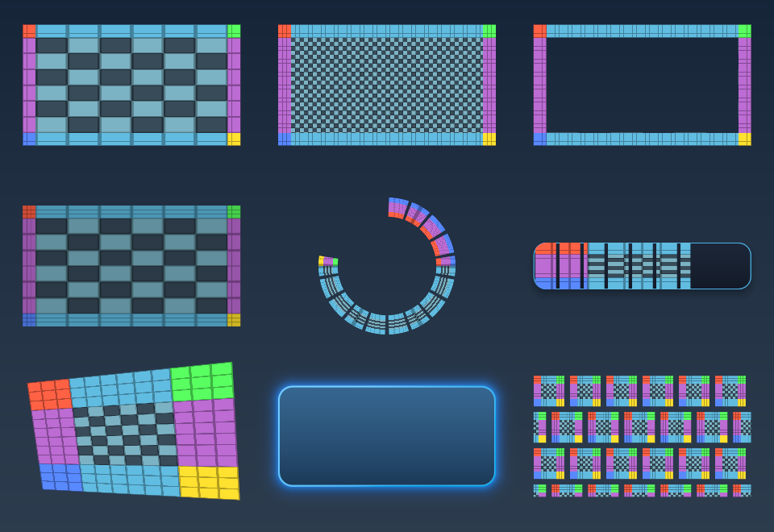
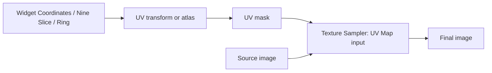

# UI UV Library

22 standalone effects and 24 composed function graphs for interface textures: cap-preserving panels, tiled centers, hollow borders, sprite atlases, explicit-time flipbooks, radial fills, repeated icons and perspective cards.



Open [`examples/ui_uv_library_demo.sxl`](../examples/ui_uv_library_demo.sxl) as a document (File > Open or drop it on the canvas). It includes its graphs and a procedural source skin; no external images are required. The nine examples, left to right and top to bottom, are: stretched nine-slice, tiled nine-slice, hollow eight-slice, atlas nine-slice, segmented radial progress, segmented progress bar, perspective card, procedural button and repeated icons.

For a reusable node, use the graph node menu > Library > **UI UV ...**. Double-click a function node to enter its graph. Set its input pins in Properties and open Variables for the additional controls. The standalone shaders appear under **UI UV** in the effects browser, organized by Slicing, Coordinates, Atlas, Masks, Sampling, Draw, Effects, Blend and Debug. Source-tree builds discover these files directly; packaged builds must include the new shaders and functions.

## Coordinate-field workflow

A UV map is an image carrying **R = U, G = V, B = coverage, A = 1**. Coverage is a separate scalar inside the field, not its alpha. Keep this format between coordinate nodes. A coordinate field is data: use a **32-bit float document** for accuracy, particularly for large textures, negative coordinates and repeated UVs. Applying a color adjustment or exporting the field to an sRGB PNG changes the coordinates. The Field Preview effect produces a regular diagnostic image and must not be fed back into a coordinate input.



Connect the source image to **Texture Sampler / Image**, and the coordinate field to **Texture Sampler / UV Map**. Its optional Mask uses the red channel, where white means visible. The sampler applies field coverage, source alpha, mask, tint alpha and opacity together using premultiplied colors. Bilinear lookups use explicit four-texel interpolation in Texture Sampler, Sprite Flipbook and mapped Displacement to keep float32 filtering consistent across backends. Its default Clamp addressing keeps partially covered fractional widget edges antialiased; use the addressing controls when coordinates themselves must clip or repeat. Coordinate operators preserve coverage unless they deliberately clip it. A missing UV Map uses document coordinates. A missing source image produces transparent output. A missing displacement input leaves the field unchanged. Displacement consumes RG as linear data; its Neutral RG control defaults to (0.5, 0.5) and can be adjusted to match the supplied map.

Most functions provide **Image**, **UV Map** and **Coverage** outputs. Nine Slice Panel also provides Center Mask and Border Mask. Panel Skin States provides Normal, Hover, Pressed, Disabled and UV Map. Styled Button provides only Image. Bake Skin PNG provides Baked Image and an Export PNG event button.

## Sizes, source regions and pixels

All pixel sizes, margins, offsets, radii and scales accept fractional values. A widget size of **375.5 x 75.25 px** is valid. Widget position is document UV; (0.5, 0.5) is the canvas center. Widget anchor is the point inside the widget placed at that position: (0, 0) is its top left and (0.5, 0.5) its center. A zero widget dimension selects the corresponding canvas dimension. The widget does not resize the document.

Shader image inputs share document coordinates. They do not expose an independent original bitmap size to an effect. **Source region origin / size (UV)** select the occupied source rectangle in that document. **Logical source size (px)** defines the original skin dimensions for margin widths and tile density. A zero logical dimension uses the selected region's actual document texel count. If a 64 x 64 source was resized to fill a larger canvas, set logical size to 64 x 64 when its margins should still mean original source pixels. Set the source region as well if the source only occupies part of the canvas. For Image Fit, Source aspect size controls aspect ratio; it does not crop a source region.

For a grid atlas, use **Atlas Nine Slice**, set the grid and frame, and set **Cell Logical Size** to the original cell dimensions. It slices local cell coordinates before mapping them into the selected cell. Keep the slice source region at its default full local rectangle in this function. Atlas gutter values are measured in actual document pixels per cell side, after any resizing of the atlas image.

## Nine-slice, eight-slice and three-slice

1. Add **UI UV Nine Slice Panel** and connect a skin image.
2. Set Widget Size, Widget Position, Logical source size and the four source margins.
3. Choose Fraction margins (0.25 means one quarter of the source dimension) or Pixels (for example 16 px on each side).
4. Choose the Center mode and Edge mode independently, then adjust Tile scale, Tile phase and Tile fitting.

The four corners preserve their source proportions at **Border scale = 1**. Horizontal edges only stretch or repeat horizontally; vertical edges only stretch or repeat vertically. The center can Stretch, Tile, Mirror tile or be Transparent. **Eight Slice Border** starts with a transparent center and repeated edges. Switching its center mode back to Tile produces a filled panel with a repeated center. **Tiled Center Panel** starts with both center and edges tiled; they remain independently adjustable.

**Tile scale** is target pixels per logical source pixel: 1 is native density, 2 doubles the displayed tile size. Phase is in tile cycles, including negative values. Natural partial tiles keep native density and crop the final tile. Round to whole tiles fits a whole number of tiles to the available span. Mirror tile alternates the direction of consecutive tiles. It is a mapping operation; ordinary tiling still needs a source with matching opposite edges for seamless artwork.

Opposing source margins are normalized when they would consume the entire source, leaving an interior of one logical source pixel. If a destination is smaller than its borders, the opposing destination borders shrink proportionally. Its center collapses without division by zero or overlapping corners. Every slice clamps its bilinear lookup to its own texel centers to reduce bleeding across slice boundaries; this can flatten half a texel near a slice seam.

Three Slice Horizontal and Vertical retain two end caps, with a stretch/repeat/mirror middle. Cap lengths are source pixels. The dimension perpendicular to the bar is stretched to the widget size.

This follows the panel/border/tiling vocabulary used by Slate/UMG brushes; it is a Shaderixel texture-processing library, not an importer for Unreal widget assets. See Epic's [FSlateBrush API](https://dev.epicgames.com/documentation/unreal-engine/API/Runtime/SlateCore/FSlateBrush).

## Atlases, animation and progress

**Atlas Icon** selects a zero-based cell in a regular columns-by-rows grid. Row zero is at the top unless Rows start at top is disabled. Frame indices can wrap (including negative values) or clamp. Gutter and a half-document-texel inset isolate bilinear reads from neighboring cells. This is a regular grid atlas, not a packed atlas with arbitrary per-sprite rectangles or rotation metadata. Sample a standalone arbitrary source rectangle with the slicing effect's source-region controls.

**Flipbook Sprite** computes `frame = Time (seconds) * Frames Per Second` in its graph. First frame, playback count, loop/clamp and interpolation are exposed. A zero playback count uses the remaining cells. Frame interpolation blends premultiplied source colors. There is **no internal realtime clock** in these shaders: animate or connect the Time input to advance playback. Scrolling Pattern and Wavy Banner use the same explicit-Time convention. Leaving Time at zero produces a static, editable result.

**Radial Progress** maps a horizontal strip around a ring: U follows the arc and V follows the ring thickness. The start angle is -90 degrees (top), positive angles run clockwise in image coordinates, and radii are document pixels. Set span below 360 for an open arc. Progress clips angular U; segments and gaps follow that same arc. Its antialias scale follows ring radius, thickness and arc span. **Ring to Strip** performs the inverse lookup for an existing source ring.

**Progress Bar** and **Segmented Progress** composite a clipped textured fill over an independently styled track. Progress 0 hides the fill and Progress 1 fills it completely (segment gaps remain when enabled). Direction can be horizontal, vertical or radial in the standalone Progress Clip effect. Radius and softness are local-space pixels. Perform rounded clipping before an atlas or affine operation when the mask should stay attached to the widget.

Interaction State exposes continuous hover, pressed and disabled amounts. These controls create skin variants or respond to graph values; they do not register pointer events on a widget. Perspective Quad accepts four clockwise corners in document UV and uses a projective mapping. Degenerate or nonconvex quads produce zero coverage.

## Export

**UI UV Bake Skin PNG** exposes an **Export PNG** event. Set the file name, then trigger the event to bake the current graph result and export it. Until the first bake, its output is live. The output is the **entire document canvas**, including any transparent area around the widget. For a tight sprite export, create a document matching the widget size, center the widget and use that same size. The tool does not resize or crop the document and does not write files until its event is triggered.

## Files added

### Standalone shaders (`shaders/effects/`)

- [`ui_uv_coordinates.slang`](../shaders/effects/ui_uv_coordinates.slang) - Coordinate field: R=U, G=V, B=coverage, A=1. Zero size selects the document dimension.
- [`ui_uv_fit.slang`](../shaders/effects/ui_uv_fit.slang) - Aspect-correct contain, cover or stretch inside an independently positioned widget.
- [`ui_uv_affine.slang`](../shaders/effects/ui_uv_affine.slang) - Transforms coordinates only; coverage remains in widget space. Chain addressing before the sampler.
- [`ui_uv_address.slang`](../shaders/effects/ui_uv_address.slang) - Independent clamp, repeat, mirrored repeat and transparent addressing; handles negative coordinates.
- [`ui_uv_nine_slice.slang`](../shaders/effects/ui_uv_nine_slice.slang) - Nine-region mapping with independent center and edge tiling, pixel or fractional margins, atlas region, masks and hollow eight-slice borders. Tiny destinations compress borders proportionally.
- [`ui_uv_three_slice.slang`](../shaders/effects/ui_uv_three_slice.slang) - Horizontal or vertical cap-preserving mapping for progress bars and buttons, with tiled or stretched middle.
- [`ui_uv_atlas.slang`](../shaders/effects/ui_uv_atlas.slang) - Selects a grid atlas cell; gutter and half-texel inset prevent bilinear reads from adjacent cells.
- [`ui_sprite_flipbook.slang`](../shaders/effects/ui_sprite_flipbook.slang) - Explicit frame-driven sprite-sheet animation with constrained range, loop/clamp and premultiplied frame blending.
- [`ui_uv_polar.slang`](../shaders/effects/ui_uv_polar.slang) - Maps a texture strip around an aspect-correct ring or arc; U follows angle and V follows radius.
- [`ui_uv_unwrap.slang`](../shaders/effects/ui_uv_unwrap.slang) - Inverse polar map: samples a source ring into a rectangular strip using document-pixel radii.
- [`ui_uv_repeat_grid.slang`](../shaders/effects/ui_uv_repeat_grid.slang) - Pixel-sized repeating icons or strips with gaps, stagger, mirroring and explicit scroll offsets.
- [`ui_uv_wave.slang`](../shaders/effects/ui_uv_wave.slang) - Cross-axis sine warp in pixel units. Phase is explicit and can be driven by graph Time inputs.
- [`ui_uv_displace.slang`](../shaders/effects/ui_uv_displace.slang) - RG displacement in document or mapped space, with optional strength mask and neutral-value control.
- [`ui_uv_projective.slang`](../shaders/effects/ui_uv_projective.slang) - Inverse homography for perspective-correct UI cards. Degenerate and nonconvex quads produce zero coverage.
- [`ui_uv_mask_rect.slang`](../shaders/effects/ui_uv_mask_rect.slang) - Per-corner rounded rectangle or hollow border clips the field coverage; inverse and mask output are available.
- [`ui_uv_mask_progress.slang`](../shaders/effects/ui_uv_mask_progress.slang) - Linear, vertical or radial progress with reverse fill, segmented gaps, pixel antialiasing and mask output.
- [`ui_uv_sample.slang`](../shaders/effects/ui_uv_sample.slang) - Final premultiplied image lookup. Image input 0, coordinate field input 1, optional mask input 2.
- [`ui_draw_panel.slang`](../shaders/effects/ui_draw_panel.slang) - Analytic rounded panel with gradient, border, bevel, shadow and glow; no neighbor sampling needed.
- [`ui_draw_slice_test.slang`](../shaders/effects/ui_draw_slice_test.slang) - Diagnostic skin with distinct corners, edge colors, center checkers and optional 4 by 4 atlas.
- [`ui_effect_state.slang`](../shaders/effects/ui_effect_state.slang) - Continuous hover, pressed and disabled controls for graph-driven UI skin variants; states are explicit inputs.
- [`ui_blend_clip.slang`](../shaders/effects/ui_blend_clip.slang) - Premultiplied over/add/multiply/screen with optional alpha clipping and an independent mask.
- [`ui_uv_field_view.slang`](../shaders/effects/ui_uv_field_view.slang) - View coverage, U, V, UV colors, checker distortion or a grid.

### Composed functions (`library/functions/`)

- [`UI UV Atlas Icon.sxfn`](<../library/functions/UI UV Atlas Icon.sxfn>) - Extract a padded atlas cell into a rounded, pixel-sized icon; frame indexing is zero based.
- [`UI UV Atlas Nine Slice.sxfn`](<../library/functions/UI UV Atlas Nine Slice.sxfn>) - Nine-slice a selected atlas cell. Set logical source size to the cell pixel dimensions; source margins belong to that cell.
- [`UI UV Bake Skin PNG.sxfn`](<../library/functions/UI UV Bake Skin PNG.sxfn>) - Bake and export a sliced UI skin through the Export PNG button. Exports the document canvas; match canvas and widget dimensions for tight export.
- [`UI UV Displaced Image.sxfn`](<../library/functions/UI UV Displaced Image.sxfn>) - Rounded viewport, masked RG displacement, explicit addressing and a single final image lookup.
- [`UI UV Eight Slice Border.sxfn`](<../library/functions/UI UV Eight Slice Border.sxfn>) - Cap-preserving UI skin with independent edge and center modes. Image + UV Map + Coverage outputs; all sizes accept decimals.
- [`UI UV Flipbook Sprite.sxfn`](<../library/functions/UI UV Flipbook Sprite.sxfn>) - Time (seconds) multiplied by FPS drives a constrained sprite-sheet animation. Time is explicit, not an internal clock.
- [`UI UV Image Fit.sxfn`](<../library/functions/UI UV Image Fit.sxfn>) - Contain, cover or stretch an image inside a positioned, independently sized rounded widget.
- [`UI UV Nine Slice Panel.sxfn`](<../library/functions/UI UV Nine Slice Panel.sxfn>) - Cap-preserving UI skin with independent edge and center modes. Image + UV Map + Coverage outputs; all sizes accept decimals.
- [`UI UV Panel Skin States.sxfn`](<../library/functions/UI UV Panel Skin States.sxfn>) - Slice a texture skin once, then derive normal, hover, pressed and disabled image outputs from the shared sample.
- [`UI UV Perspective Card.sxfn`](<../library/functions/UI UV Perspective Card.sxfn>) - Perspective-correct four-corner card with continuous hover, pressed and disabled skin controls.
- [`UI UV Pixel Margin Panel.sxfn`](<../library/functions/UI UV Pixel Margin Panel.sxfn>) - Cap-preserving UI skin with independent edge and center modes. Image + UV Map + Coverage outputs; all sizes accept decimals.
- [`UI UV Progress Bar.sxfn`](<../library/functions/UI UV Progress Bar.sxfn>) - Rounded background panel plus textured foreground clipped by progress; the empty track stays visible.
- [`UI UV Radial Progress.sxfn`](<../library/functions/UI UV Radial Progress.sxfn>) - Map a texture strip around a ring or arc, then clip angular U by progress. Segments follow the arc; all controls are explicit.
- [`UI UV Repeated Icons.sxfn`](<../library/functions/UI UV Repeated Icons.sxfn>) - Pixel-sized icon grid with gaps, alternate-row stagger, mirror controls and explicit pixel scrolling.
- [`UI UV Ring to Strip.sxfn`](<../library/functions/UI UV Ring to Strip.sxfn>) - Unwrap an existing source ring into a positioned rectangular strip, with a rounded output clip.
- [`UI UV Rounded Image.sxfn`](<../library/functions/UI UV Rounded Image.sxfn>) - Local widget coordinates, per-corner pixel clipping and one final image sample.
- [`UI UV Scrolling Pattern.sxfn`](<../library/functions/UI UV Scrolling Pattern.sxfn>) - Scroll and rotate a repeating texture inside a fixed rounded widget. Time is in seconds; UV movement is in cycles.
- [`UI UV Segmented Progress.sxfn`](<../library/functions/UI UV Segmented Progress.sxfn>) - Rounded background panel plus textured foreground clipped by progress; the empty track stays visible.
- [`UI UV Styled Button.sxfn`](<../library/functions/UI UV Styled Button.sxfn>) - Procedural rounded panel with gradient, border, bevel, shadow, glow and exposed interaction states.
- [`UI UV Three Slice Horizontal.sxfn`](<../library/functions/UI UV Three Slice Horizontal.sxfn>) - Fixed end caps and a stretch, repeat or mirror middle; pixel-sized bars and buttons.
- [`UI UV Three Slice Vertical.sxfn`](<../library/functions/UI UV Three Slice Vertical.sxfn>) - Fixed end caps and a stretch, repeat or mirror middle; pixel-sized bars and buttons.
- [`UI UV Tiled Center Panel.sxfn`](<../library/functions/UI UV Tiled Center Panel.sxfn>) - Cap-preserving UI skin with independent edge and center modes. Image + UV Map + Coverage outputs; all sizes accept decimals.
- [`UI UV Transform Stack.sxfn`](<../library/functions/UI UV Transform Stack.sxfn>) - Composable optional coordinate input, affine transform, independent addressing and one texture lookup. Leave UV Map disconnected for document coordinates.
- [`UI UV Wavy Banner.sxfn`](<../library/functions/UI UV Wavy Banner.sxfn>) - A sine-warped image sampled once inside a fixed rounded viewport. Time drives wave phase; amplitudes are pixels.

### Example, reference and validation

- [`examples/ui_uv_library_demo.sxl`](../examples/ui_uv_library_demo.sxl) - Self-contained nine-widget document with embedded graphs and procedural source skins.
- [`docs/images/ui_uv_library.png`](images/ui_uv_library.png) - Actual canvas render of that example.
- [`docs/UI_UV_LIBRARY.md`](UI_UV_LIBRARY.md) - This English usage guide and complete file inventory.
- [`tools/test_ui_uv_library.py`](../tools/test_ui_uv_library.py) - Static graph validation and numerical/rendering checks for both GPU backends.

## Validation commands

```powershell
python tools/test_ui_uv_library.py
python tools/test_ui_uv_library.py --gpu --backend both
```

GPU checks need the Release executables and Pillow. They create fixtures, images and individual logs under `build/ui_uv_tests/`, start the application minimized, wait for each process to exit by itself, and never send mouse or keyboard input. They check numerical slice coordinates, preserved corners, repeated center/edges, transparent center, small targets, fractional widget edges, three-slice caps, mirrored negative phases, whole-tile fitting, source subregions, negative addressing, padded atlas selection, projective mapping, degenerate quads, aspect fit, progress endpoints, rounded clipping, neutral displacement, premultiplied blending, disabled colors, exact bilinear and nearest filtering, flipbook interpolation, and a nonempty render from each of the 24 functions. The export tool is rendered in live mode; its file-writing event is not triggered by the test.

Compile the full effect library with `build\Release\Shaderixel.exe --test-effects`, started minimized, then wait for its self-exit and inspect `[test-effects]` in `shaderixel.log`. Use `ShaderixelVk.exe --test-effects` for Vulkan. Successful effect compilation alone does not validate function wiring; the graph and GPU checks above cover that separately.

Validation on the development Release build: **434 / 434 effects** and **198 / 198 existing visual effect graphs** compiled on both Direct3D 12 and Vulkan; **49 GPU fixtures per backend** (98 total) passed. The self-contained example was also rendered on both backends and its PNG outputs are pixel-identical. Compile logs are kept at `build/ui_uv_compile_d3d12.log` and `build/ui_uv_compile_vulkan.log`; fixture logs are under `build/ui_uv_tests/`.
