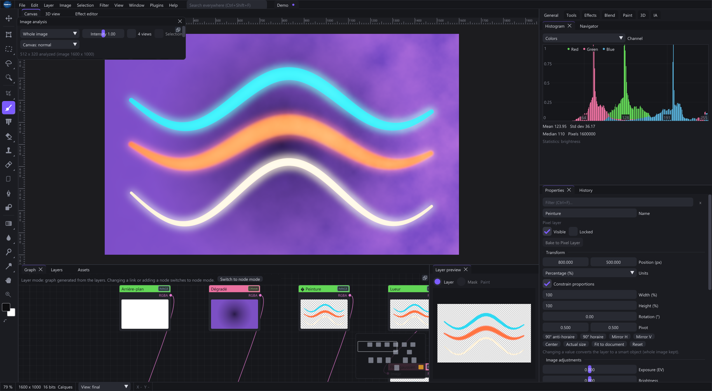

# Getting started

Shaderixel is a GPU image editor with a layer stack and an image node graph. The separate visual effect graph builds the calculation inside one effect.

Help > Documentation or F1 opens this manual without an Internet connection. Search covers the handbook, shipped effects/functions, toolbar tools, brushes, recorded commands and all built-in node operations. User-installed presets may not be listed.

F1 uses the focused panel: a selected effect opens its library reference, while a painting tool or editor opens its handbook chapter. Properties also has Selection help; the graph node context menu offers the same command. Unknown or renamed functions open the libraries chapter, and custom effect overrides open effect authoring. Inside the manual, F1 retains the current article. Help > Documentation resumes the last article.

Use In this chapter to jump to a section and Text size to choose 85–150% reading size. These controls work in both the native and browser editions. Text size and the manual language override last for the session.

## Install and launch

Use the Windows x64 installer or extract the portable ZIP into a writable folder. Windows 10 version 2004 or later and a D3D12-capable GPU are required for Shaderixel.exe; ShaderixelVk.exe uses a compatible Vulkan driver. The per-user installer includes the runtime libraries and does not need administrator rights.

Use Help > Check for updates for the public GitHub channel. Startup and prerelease checking are configurable there. Save your editable projects separately from delivery images and keep external linked assets with the project.

## First image in five minutes

1. Choose File > New, set canvas width, height and precision, and start in Layers mode. Alternatively open an image with Ctrl+O.
2. Select a pixel layer in Layers, choose Brush (B), pick a foreground color and paint.
3. Apply an effect as a layer filter. Change its parameters in Properties; disable the filter to compare.
4. Add a layer mask to hide part of the layer. Select the image thumbnail again before painting color.
5. Save with Ctrl+S as a native document. Use File > Export or Export As for a delivery image.

A checkerboard means transparency. An empty pixel layer needs paint or a fill before it becomes visible.

## Choose a starting point

- Photo editing: open the photo and try Photo Essentials Develop.
- Material extraction: connect an image to PBR Photo to Maps in the main graph.
- UI panels: use a 32-bit float graph document and UI UV Nine Slice Panel.
- Model painting: create a Paint 3D project and choose or import a mesh.

[Workspace and navigation](#workspace)
[Main image graph](#image_graph)
[Photo to PBR maps](#pbr)
[UI textures and slicing](#ui_textures)

## Find a complete procedure or reference

Guided projects includes seven worked exercises and six openable practice files. The built-in node index distinguishes image graphs, per-pixel shaders and explicit execution. The panel directory explains every registered panel/dialog. Settings covers interface/tablet/history/AI preferences and the update flow; Delivery and Recovery cover the final checks and common failure paths.

[Complete built-in nodes](#builtin_nodes)
[Panel and dialog directory](#panels)
[Settings and updates](#settings)
[Asset delivery](#delivery)
[Diagnosis and recovery](#recovery)
