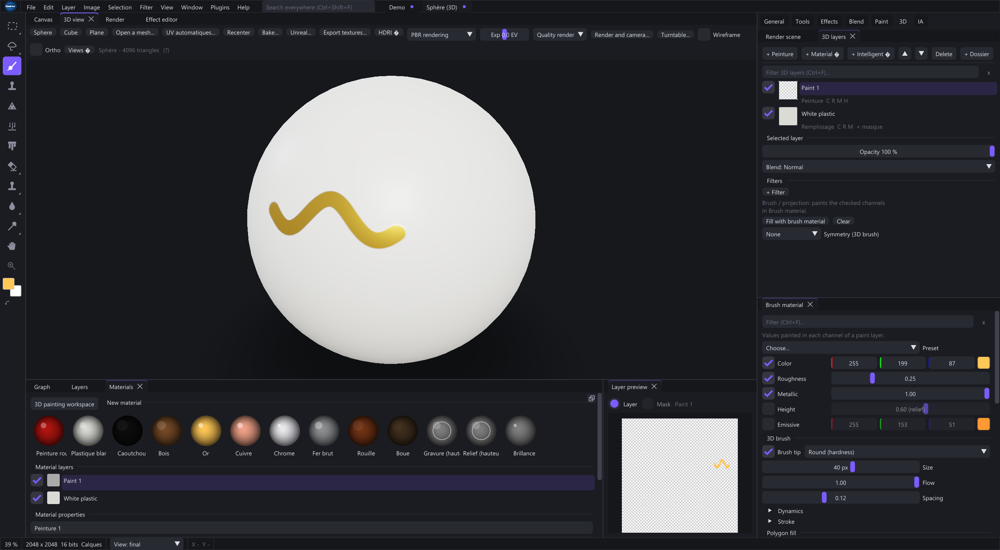

# Paint 3D, materials and baking

Create a Paint 3D project from File. Import a supported mesh or choose a primitive. Inspect UVs and texture resolution before detailed painting.

## First material from start to delivery

1. Create the project with a suitable texture resolution and a primitive or imported mesh. Inspect the checker and material assignments before painting.
2. Choose a material/texture set. Add a fill layer with base color and roughness; disable channels it should not change.
3. Add a paint layer or mask, select its target and paint a test mark. Check the active 3D material channels.
4. Rotate the model and inspect seams, back faces and small UV islands. A good flat preview can hide poor UV coverage.
5. Add a smart material or geometry-based mask after its required maps are available. Inspect mask coverage before increasing contrast.
6. Save .sx3d, export the channel set and validate it on the mesh in the receiving engine.

Start with a full base layer, then localize paint/wear, cavity dirt and directional dust. Roughness and metalness are numbers rather than cosmetic RGB tints. Follow-layer masks can anchor on, at the edge of, around or away from another layer; preserve that relationship when reordering.

For image fills, inspect UV/triplanar mapping, scale, rotation and offsets. Baked photo lighting may look plausible in base color while giving incorrect roughness/height estimates. Inspect individual channels under neutral lighting.

## Channels and materials

Channels include base color, roughness, metalness, normal, emissive, occlusion and height. Choose the channels affected by a material layer and paint its mask/content using the active tool.

The 3D view evaluates the material on the mesh. Lighting/HDRI changes the preview, not the exported base-color pixels. Use channel views to diagnose unexpected shading.

Automatic unwrapping supplies UVs for a mesh without them. Review seams, packing and texel density before relying on the layout.

## Smart materials

Smart materials assemble fills and masks such as edge wear, cavity dirt, dust, gradients and noise. Some use baked maps: occlusion, convexity, concavity or thickness.

Choose a smart material in the 3D layer controls and inspect each mask. User materials are saved in %LOCALAPPDATA%\Shaderixel\SmartMaterials. A smart material is different from a 2D smart object.

## Baking and delivery

The File menu exposes the map baker for Paint 3D projects. Check mesh, UVs, map resolution and bake settings, then inspect the results.

Mesh-map baking derives information from geometry. Bake to Pixel Layer rasterizes one 2D layer. A graph Bake action retains an image result. These are separate operations.

Export Project Textures writes material channels. Export for Unreal and the connector support engine delivery; check normal convention, channel packing and color-space flags there.

[Photo to PBR maps](#pbr)
[Export and delivery](#export)
