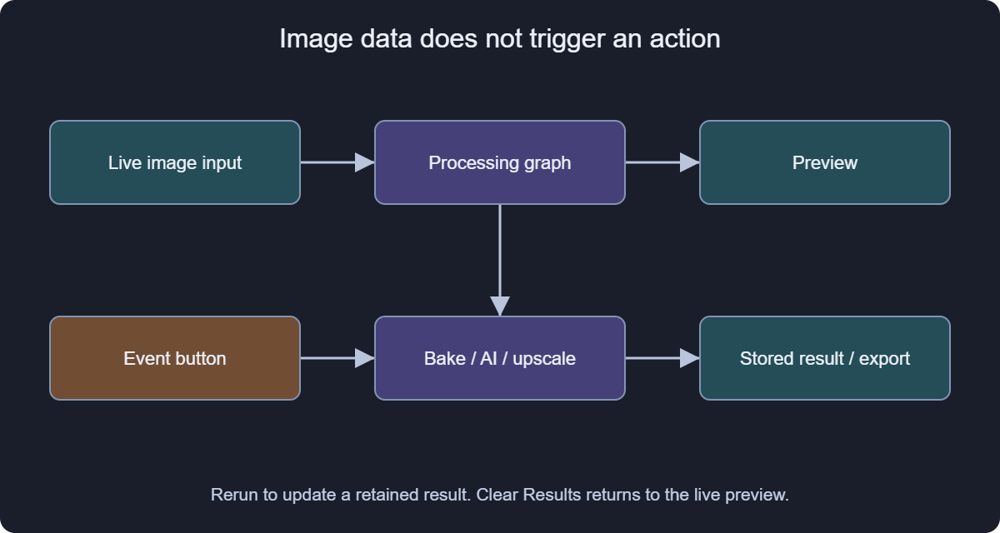

# Functions, execution and automation

Subgraphs calculate live. Tools execute named events. An output can represent live input or a retained result; inspect its state.

## Events and results

Select a tool and trigger its event in Properties. White execution links define action flow; image links provide data. An image connection alone does not trigger export or AI.

Bake retains a computed image. Upscale and ComfyUI retain results after execution. Clear Results restores live-input preview. Upstream edits do not regenerate retained results automatically.

Sequence fixes order, Branch chooses a path, and range/foreach loops change values between actions. Exposed variables belong to each function instance.

## Reuse and actions

Select nodes and create a subgraph/tool from the context menu. Add named ports and exposed variables, test defaults and optional masks, then save in Library. A .sxfn should be pixel-free; stored pixels can require a native document companion.

Actions records supported editor commands; Action Editor edits their sequence. File > Automation > Batch applies an action to several files. Bake to Pixel Layer is recordable. Not every gesture or external result becomes an action; test on a copy before a batch.

The dedicated action guide explains recording, partial runs, JSON import, folder/open-document batches and output conflicts. The Commands category references all 20 command types. Select a step in Action Editor and use F1 or Command help for its parameters and factory defaults.

## Variants

Exposure brackets and sprite flashes use arrays/loops. Suffixes may be array indices rather than parameter values. A tool may retain the last variant and leave variables at the last value.

Check prefix and destination before execution. These tools write files only when their events run.

[Main image graph](#image_graph)
[Authoring effects and reusable presets](#authoring)
[Recorded actions and batch guide](#actions)
