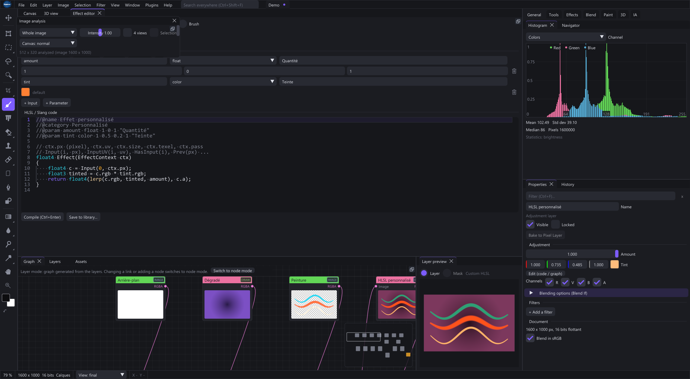

# Authoring effects and reusable presets

An effect is a .slang shader; a reusable image-graph function is .sxfn JSON. The formats differ even when edited visually.

## Shaders

The .slang filename is the stable ID. Use lowercase letters, digits and underscores. Translated labels must not change that identity.

Define float4 Effect(EffectContext ctx). Metadata //@name, //@category and //@param supplies names and controls. //@generator declares Draw; //@blend declares a blend. Neighbor reads need appropriate //@halo metadata for tiled rendering.

## Functions

subinput/suboutput nodes define ports; exposed variables become instance controls. kind is subgraph for live calculation or tool for event/action workflows.

All referenced effects must exist. Inputs follow actual pin order; parameter pins follow image inputs. Multi-output links need the right source port. Avoid cycles.

Save an editor-created example before hand-editing JSON. This preserves current field names and value formats.

## Locations and validation

Source functions live in library/functions; installed ones in functions beside the executable; user functions in %LOCALAPPDATA%\Shaderixel\Functions. Effects live in shaders/effects. Modify a copy of protected supplied effects.

Shaderixel.exe --test-effects compiles effects, then exits. Inspect [test-effects] in shaderixel.log. Compilation and graph validation are separate: a valid shader does not prove a tool's wiring/export is correct.

The source repository has docs/PRESETS.md for the detailed preset schema and docs/PLUGINS.md for APIs. The embedded catalog records shipped defaults rather than user overrides.

[Visual effect graph and shader editor](#effect_editor)
[Functions, execution and automation](#automation)
