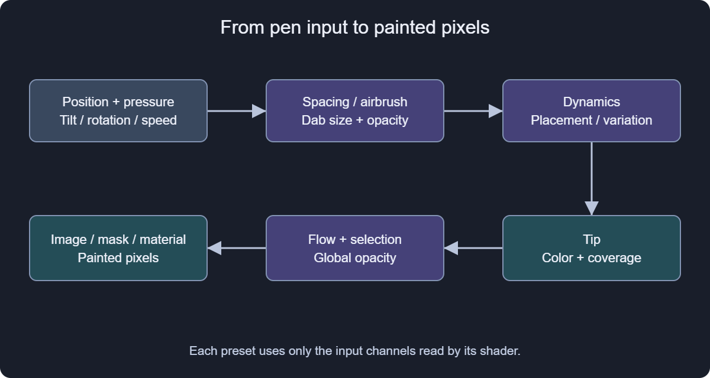
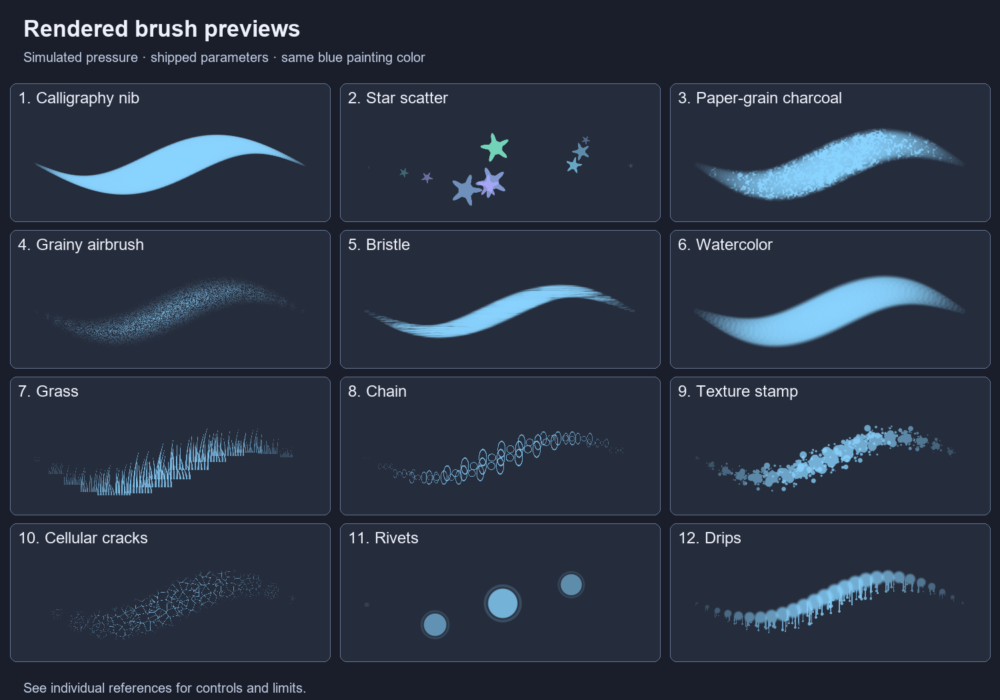

# Brush libraries and tablets

## Choose and configure a brush

Open Help > Brushes for this index. In the Brushes panel, select a preset and use Brush help or F1 to open its own reference. The eraser has an independent tip selection. Standard Round opens this guide; custom code and graph copies open the authoring guide.

The Brushes panel groups presets by category and search. A programmable brush defines its tip and dab placement; available parameters depend on that brush. Spacing, scattering, size/angle variation and airbrush behavior can change the stroke substantially.

Test a short stroke at the intended document scale. Very large tips, dense spacing and expensive tip shaders can increase GPU work. A mask target records coverage, while an image target records color.

## Import and create

File > Import Resources supports Photoshop .abr brushes. Imported resources and procedural brush shaders are different formats; inspect the resulting tip and dynamics.

The brush editor can create a brush from a template, edit its code or graph, and save it in the library. Ctrl+Enter compiles in the applicable code editor. Brush textures provide image-based tips; changing a texture can change the stroke independently of size/spacing.

## Tablet input

Tablet options offer Windows Ink and Wintab. Pressure, tilt, pen rotation and speed can feed brush dynamics where the brush supports them. Use the pressure curve and test area to check response before painting important work.

If pressure remains constant, check the selected input backend, driver and brush's pressure mapping. Wintab needs a compatible installed driver; a mouse cannot provide all pen channels. A brush must actually use a channel for that input to affect the result.

## Understand a stroke

1. Choose an unlocked pixel layer and its image or mask thumbnail. For procedural content, convert to a pixel layer before painting. In Paint 3D, check the active material channel instead.
2. Pick a tip. Selection applies its declared spacing, measured as a fraction of brush diameter. A value of 0.1 is a tenth of a diameter; 1.2 separates centers by more than a diameter.
3. Set size, opacity, flow and supported pressure controls. Double-click or Ctrl+click a numeric field to type a decimal value; Enter confirms, Escape cancels.
4. Test a curved stroke and a stationary press. Only presets with airbrush timing accumulate extra dabs while held still. A spray-like shape alone does not imply timed painting.
5. Compare overlap at the final document scale. High opacity does not replace missing coverage inside grainy tips. Dense spacing can fill small gaps and makes more GPU work.

Tip returns color and coverage. Dynamics can alter the center, angle, radius or color of a dab. Extent reserves a wider calculation area for such marks; increasing extent alone does not scatter a brush. Self-flow presets apply flow and pressure inside the tip; ordinary presets use the renderer's dab-opacity multiplication. Both retain global opacity and selection limits.

Length, width and noise settings generally use tip coordinates rather than document pixels. A color parameter has RGBA components; angle parameters such as Rotation, NibAngle and Slant use radians (about 1.5708 is a quarter turn). Stable parameter identifiers in square brackets let you identify a control in either language.

## Troubleshooting and safe editing

- No paint: check layer lock, active mask/image target, selection, opacity, flow and foreground color. Compare with Standard Round to separate target problems from a procedural tip's sparse coverage.
- Missing texture: choose a readable image in the preset's texture slot. Images without alpha receive luminance-derived coverage; a white background can therefore paint as part of the stamp.
- Hardness seems inactive: not every shader reads the shared hardness value. Some tips define their own softness or fixed edge thresholds; consult that preset's page.
- A changed brush does not match the reference: the reference describes shipped defaults. Edited code/graph copies and replaced textures can change the result. Selecting a shipped preset again resets its shader parameters and texture overrides.
- Rust, rivets and cracks are coverage/color motifs. They do not infer geometry, detect model edges or generate a full PBR material by themselves. Paint the intended material channel explicitly.

## Rendered examples

These are actual GPU previews with simulated pressure, not tablet measurements. All use the same blue painting color, 110 px requested size, 0.7 hardness, 0.8 flow and full opacity; the preview limits the effective diameter to fit its height. Spacing and shader parameters retain the preset defaults. The numbered examples identify selected tips in the catalog below. A watercolor appearance does not run a fluid simulation.

[Painting and retouching](#painting)
[Effect and brush authoring](#authoring)

## Shipped brush catalog

### Examples

[Grainy airbrush](#brush:airbrush)

[Calligraphy nib](#brush:calligraphy)

[Paper-grain charcoal](#brush:charcoal)

[Star scatter](#brush:star_scatter)

### Materials

[Bristle](#brush:cy_bristle)

[Chalk](#brush:cy_chalk)

[Charcoal](#brush:cy_charcoal)

[Dry media](#brush:cy_dry_media)

[Ink bleed](#brush:cy_ink_bleed)

[Rake](#brush:cy_rake)

[Sponge](#brush:cy_sponge)

[Watercolor](#brush:cy_watercolor)

### Shapes

[Calligraphy](#brush:cy_calligraphy)

[Cross](#brush:cy_cross)

[Diamond](#brush:cy_diamond)

[Ellipse](#brush:cy_ellipse)

[Halftone](#brush:cy_halftone)

[Hexagon](#brush:cy_hexagon)

[Leaf](#brush:cy_leaf)

[Noise](#brush:cy_noise)

[Ring](#brush:cy_ring)

[Round](#brush:cy_round)

[Soft square](#brush:cy_soft_square)

[Square](#brush:cy_square)

[Star](#brush:cy_star)

[Texture stamp](#brush:cy_texture)

[Triangle](#brush:cy_triangle)

### Details

[Chain](#brush:cy_chain)

[Crack](#brush:cy_crack)

[Fingerprint](#brush:cy_fingerprint)

[Grass](#brush:cy_grass)

[Scratch](#brush:cy_scratch)

[Stitch](#brush:cy_stitch)

### Particles

[Cloud](#brush:cy_cloud)

[Fur](#brush:cy_fur)

[Smoke](#brush:cy_smoke)

[Sparkle](#brush:cy_sparkle)

[Spray](#brush:cy_spray)

### 3D texture

[Drips](#brush:sx3d_coulures)

[Thread stitches](#brush:sx3d_couture)

[Scales and disks](#brush:sx3d_ecailles)

[Splashes](#brush:sx3d_eclaboussures)

[Cellular cracks](#brush:sx3d_fissures)

[Fine grain](#brush:sx3d_grain_bruit)

[Soft cloud](#brush:sx3d_nuage_doux)

[Dry bristles](#brush:sx3d_pinceau_sec)

[Regular dots](#brush:sx3d_points)

[Fine scratches](#brush:sx3d_rayures_fines)

[Rivets](#brush:sx3d_rivets)

[Grunge dirt](#brush:sx3d_salete)

[Rust patches](#brush:sx3d_taches_rouille)

[Clean line](#brush:sx3d_trait_net)

[Chipped wear](#brush:sx3d_usure_ecaille)
