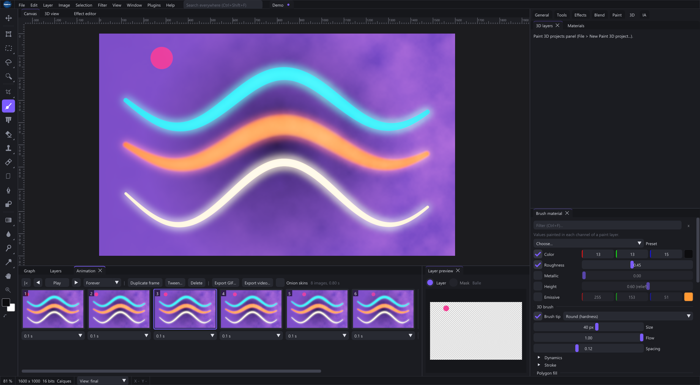

# Frame animation and video export

Animation is available for layer-mode documents. Each frame records layer state and a duration: visibility, opacity, blending, filters and smart-object placement. It is not a general-purpose bone or character animation system.

Frames reference layer content rather than copying every painted pixel. Painting a shared pixel layer changes the content of frames using it. For painted poses, keep separate layers and animate visibility, or use independent smart-object content.

Set each frame's delay; once/three-times/loop controls repetition. Onion skins compare neighboring states; return to normal viewing for final colors. Save natively before deleting frames or reorganizing pose layers.

Video export samples the sequence at 30 fps; durations use that time grid. GIF has its own timing quantization. Neither delivery format preserves the editable project. A model turntable is a separate 3D presentation operation.

## Create a sequence

1. Open the Animation panel and choose Create Animation.
2. Compose the first frame using the layer stack.
3. Duplicate the frame, then change the relevant layer states for the next pose.
4. Set frame durations and choose playback repetition.
5. Play the animation and inspect the sequence before export.

The frame strip selects the active frame. Stop playback before making precise edits. Deleting the only frame is disabled.

## Interpolation

Interpolate adds intermediate frames between the selected frame and the following one. Opacity and smart-object positions are interpolated. It does not infer object motion from arbitrary painted pixels or generate new semantic poses.

## Export

Export GIF writes an animated GIF; Export Video offers MP4. Inspect the resulting file's timing, dimensions and colors in its destination player. GIF palette/format limits can change colors; video delivery does not preserve arbitrary transparent compositing.

A library flipbook node uses an explicit frame input to sample an atlas. It is a separate mechanism from the document's animation frames.

[Layers](#layers)
[Export](#export)
