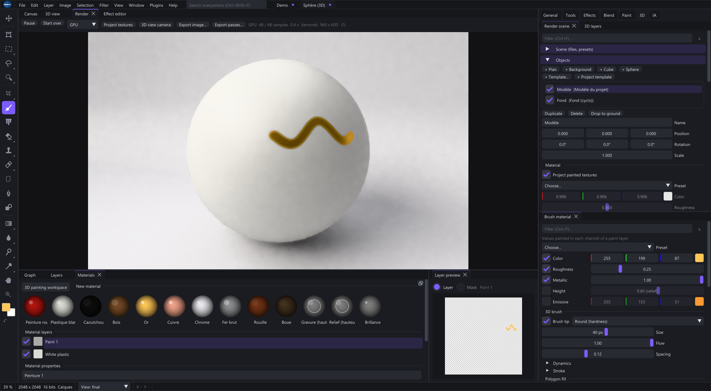

# Rendering scenes and presentation

The 3D material preview and the Render view serve different purposes. Render builds a presentation scene and accumulates samples for a final image. Keep the editable material/project as the source.

## First product render

1. Open a valid Paint 3D model/material. Render is unavailable for a plain 2D document.
2. Open Render and Render Scene. Refresh Project Textures after painting; optionally copy the 3D-view camera.
3. Choose a simple environment and one light. Set framing and dimensions before tuning samples.
4. Inspect at neutral exposure, then tune lighting, background and display curve. Fix model placement before denoising.
5. Accumulate samples, pause as needed and export image/passes. Reopen to verify dimensions and channels.

The scene offers point, spot, area and sun lights. Position/orientation, spot cone and area size have different effects. Environment visibility controls the backdrop separately from choosing HDRI. Orthographic projection differs from perspective field of view; focus distance differs from framing distance. Transmission uses an index of refraction and may need enough bounces.

Camera/light/material/scene changes restart the relevant accumulation. Denoising can conceal detail and bias low-sample previews; compare a sufficiently sampled render. CPU/GPU modes concern presentation rendering, not arbitrary 2D shader execution.

## Scene setup

Open Render and Render Scene in the 3D workspace. Choose/import scene objects, set their transforms/materials, add lights or an environment, and frame the camera. The scene panel controls those objects; the canvas layer stack controls the painted textures.

Larger area lights give softer shadows. HDRI brightness/rotation changes illumination. Camera projection, field of view and focus settings change the presentation without resizing the underlying texture maps.

## Sampling and appearance

Choose GPU or CPU rendering, sample count and relevant quality controls. Pause/resume while adjusting the scene. Accumulation reduces noise; denoising can help early previews but cannot replace correct geometry/material setup.

PBR Neutral and AgX provide different display/tonemapping choices. Exposure, a clear coat and transmission affect the final appearance. Test a neutral lighting setup when comparing an extracted material to its source photo.

## Export passes

Export the final image or its compositing passes. The supplied pass operation creates albedo, normals, depth and mask images with filename suffixes. Depth is a render-space result rather than measured surface microrelief.

Refreshing painted channels updates the render input; saving a scene preset makes a setup reusable. Keep any external meshes and HDRI files available for portable scene editing.

[Paint 3D](#paint3d)
[Color and data](#color)
