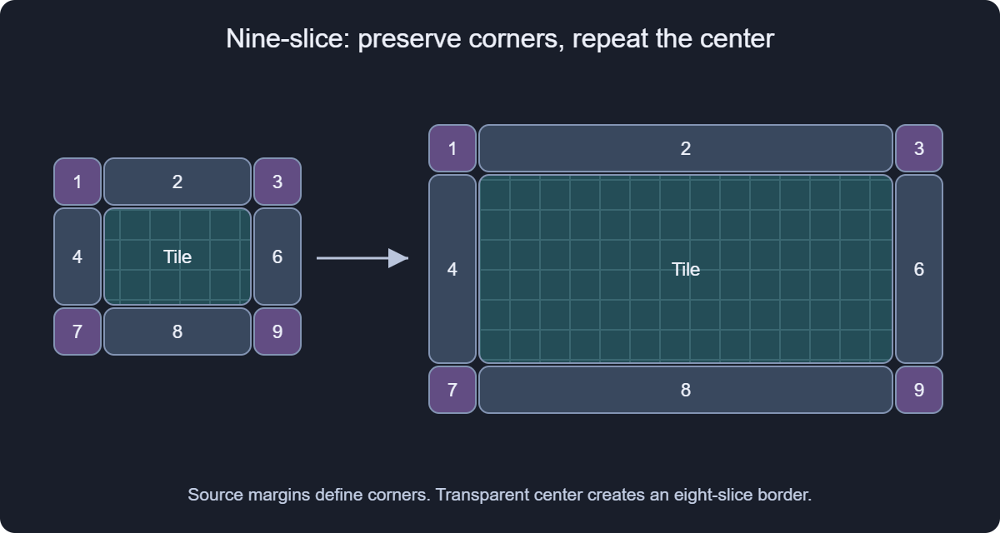
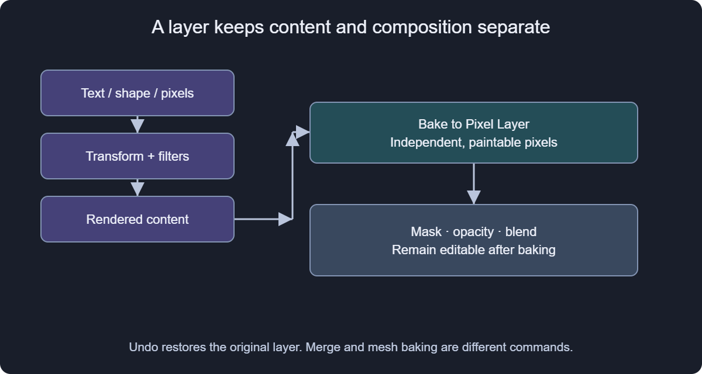
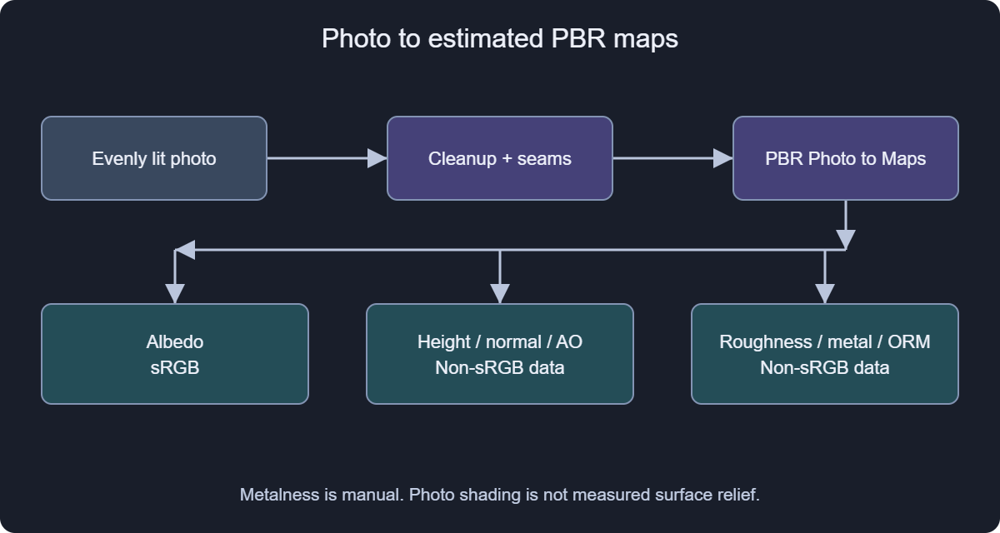
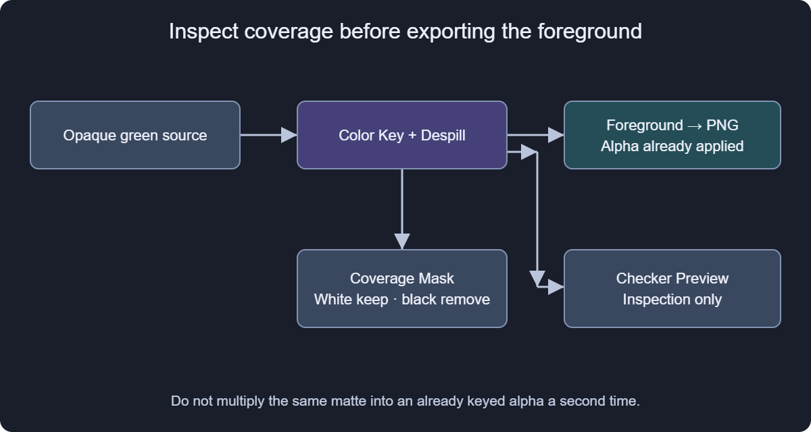
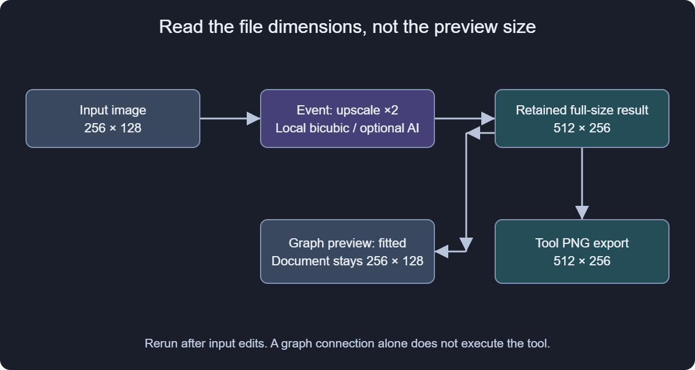
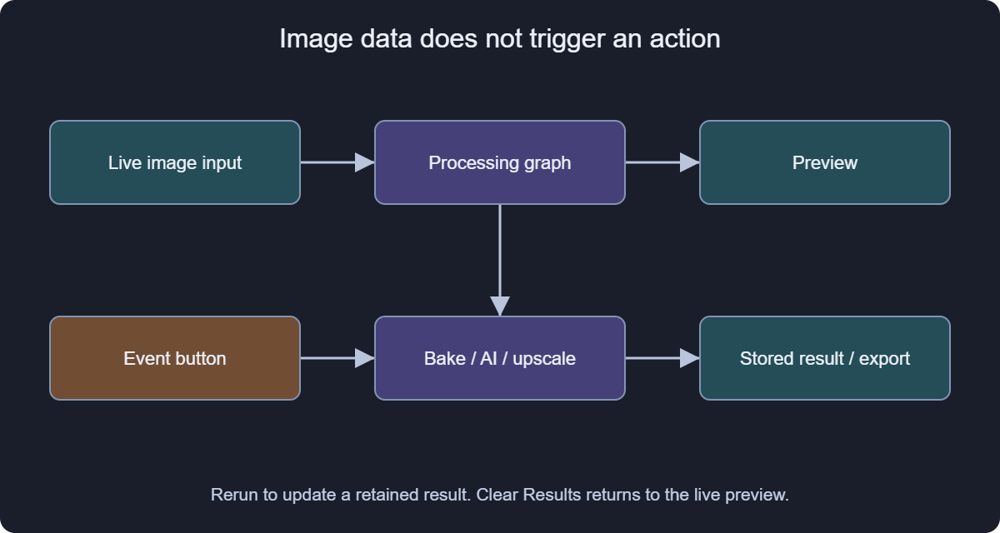

# Guided projects

These exercises use shipped effects and functions. Six practice documents contain procedural sources and their graphs, so they open without photos, downloaded assets or an AI server. Replace a practice source with your own image when you understand the connections. Opening an example does not execute exports or AI tools.

In the native reader, an example opens as an unsaved copy; use Save As to keep your work. The browser downloads a .sxl file to open in Shaderixel. If the native example button is unavailable, restore docs/manual/examples beside the executable; the embedded text and pictures still work. Help > Guided projects returns here. Use In this chapter to choose an exercise.

## 1. Resize an interface skin without stretching its corners

Goal: a 375.5 × 75.25 pixel panel centered on a 512 × 256 transparent canvas, with a repeated center. Fractional widget dimensions describe coverage inside the canvas; the exported image still has integer canvas dimensions.

[Open the nine-slice practice document](example:ui_nine_slice)

1. Select UI UV Nine Slice Panel in Graph. Its Skin Image is already connected to UI Draw Slice Test Card; its Image output is connected to Output.
2. In Properties, type Widget Size (px) = 375.5, 75.25 and Widget Position (UV) = 0.5, 0.5. Double-click or Ctrl+click numeric controls to type decimals.
3. In Variables, keep Logical source size (px; 0 = region texels) = 128, 128. Leave the four source margins at 0.25 with Source margin units = 0 (Fraction). Each corner occupies a logical 32 × 32 pixel area.
4. Set Center mode = 1 (Tile), Edge mode = 0 (Stretch), Border scale = 1 and Tile scale (target pixels per source pixel) = 1, 1. The practice file already sets the center to Tile.
5. Change Center mode to 3 (Transparent) to make an eight-slice border, then return to 1. Compare the center alpha while the corners keep their proportions.
6. Temporarily connect Coverage to Output to inspect the outline, then reconnect Image. Export the final Image as PNG and check its 512 × 256 dimensions and transparent outside area.

Expected: four differently colored corners, thin edges and a checker center. Changing width adds repetitions instead of widening the corner artwork. This skin is a diagnostic card, not a ready-made button design.

If the canvas shows red/green coordinates, reconnect Image rather than UV Map. If corners are too large, check logical source size and margin units together. With a real atlas skin, enter its source region before adjusting margins. For a tight export, choose a matching integer canvas and widget size; fractional coverage does not create a fractional-width PNG.

[Nine-slice ports and variables](#function:UI UV Nine Slice Panel)
[Sampling and UI coordinate conventions](#ui_textures)

## 2. Turn a procedural layer into paintable pixels

Goal: paint on a generated background while keeping a recoverable original and editable layer composition.

[Open the paintable-background practice document](example:bake_background)

1. Select Editable gradient in Layers. Change its gradient colors or angle in Properties and save a working .sxl copy.
2. Optionally add a layer filter. This is part of the content that the conversion will bake.
3. Choose Layer > Bake to Pixel Layer, the layer context menu command, or the button in Properties. Wait for conversion to finish.
4. Select Brush, choose a visible foreground color and paint a stroke. Select the image thumbnail if you were editing a mask; clear an unintended pixel selection first.
5. Adjust opacity or the blend mode to confirm that composition still operates on the baked layer.
6. Undo the stroke, then undo the bake. The original gradient parameters become editable again. Save the procedural version separately if you need it after closing the undo session.

Expected: the selected layer becomes a normal pixel layer and accepts painting. Its rendered content, transform and filters are baked; its mask, opacity and blend remain editable. Conversion does not merge neighboring layers. A graph Bake action retains an image result and is a different command.

If painting seems ineffective, check the active document, layer lock, mask/image thumbnail, selected area and brush opacity. A transparent canvas often means an empty graph input, a hidden layer or a zero mask, rather than a failed bake.

[Layer conversion and undo](#layers)
[Painting controls](#painting)
[Gradient generator reference](#effect:gradient_fill)

## 3. Inspect photo-derived PBR maps before export

Goal: understand the seven outputs, then substitute an evenly lit photo for the training pattern. The example uses procedural noise and demonstrates routing; it is not a measured material or an AI extraction.

[Open the PBR inspection practice document](example:pbr_maps)

1. Open the 256 × 256 example. PBR Photo to Maps receives the practice noise and Output initially displays Normals.
2. Connect Albedo, Height, Normals, Occlusion, Roughness, Metalness and ORM to Output one at a time. Keep a note of which map you are viewing.
3. Start with Detail Height = 1.5, Normal Strength = 4 and Base Roughness = 0.6. Reduce Normal Strength if detail is too harsh. Try Invert Height to understand how it changes the relief interpretation.
4. Keep Uniform Metalness = 0 for a dielectric. Set it to 1 only for a metal. Choose DirectX Normals according to the destination engine; the default is OpenGL.
5. Replace the practice noise connection with your photo. Prefer even lighting and a front-facing surface, then inspect texture seams before judging the normals. Lighting Correction and Lighting Radius estimate photo shading; adjust them rather than assuming all dark regions are holes.
6. For automatic files, insert PBR Photo to Maps and PNG Export, reconnect the photo and copy your chosen settings. Enter File Prefix in a writable output folder, then trigger Extract and Export. Previewing the node alone does not write files.
7. In the engine, import albedo with sRGB enabled and numeric maps with sRGB disabled. ORM stores occlusion in R, roughness in G and metalness in B. Inspect the material under neutral light.

Expected: seven distinct map outputs. The export tool writes prefix_albedo.png, prefix_height.png, prefix_normal.png, prefix_occlusion.png, prefix_roughness.png, prefix_metal.png and prefix_orm.png. Reusing a prefix replaces those files. PNG export here is 8-bit; choose a suitable high-precision route for displacement work that needs more depth.

If a bump appears inverted, inspect height inversion and the normal convention independently. If data looks washed out in the engine, check the import color space. An image-space depth estimate describes scene distance, not the same quantity as fine surface relief.

[Extraction ports and settings](#function:PBR Photo to Maps)
[PBR export tool](#function:PBR Photo to Maps and PNG Export)
[Material and color-space details](#pbr)

## 4. Key a colored background and inspect the matte

Goal: separate a foreground from a flat green background and learn which output is suitable for export.

[Open the color-key practice document](example:color_key)

1. The example composites a red rounded panel onto opaque green, then feeds that image into Masks Color Key and Despill. Output displays Foreground.
2. Keep Background Color = linear RGBA 0, 1, 0, 1 and Color Tolerance = 0.12. The synthetic background is exactly green; with a photo, pick its actual background color.
3. Connect Coverage Mask to Output. White keeps foreground, black removes background and gray is partial coverage. Return Foreground to Output when done.
4. Adjust Selection Softness and Feather Radius only enough to soften the boundary. Start with Contract Radius = 0; excessive contraction removes fine edges.
5. Compare Despill Strength = 0 and 0.6. Despill changes edge color, whereas the coverage controls change alpha. Connect Checker Preview only for inspection.
6. Export Foreground as PNG. Reopen the PNG or place it over a contrasting background and check the edge at 100% zoom.

Expected: the rounded panel remains opaque and the outside becomes transparent. Checker Preview contains its diagnostic backdrop; exporting it bakes that backdrop into the picture. Foreground already contains the key alpha. Do not multiply the same Coverage Mask into it a second time, or soft edges become too transparent. To build a different matte-based composite, start from an appropriate unmasked foreground and use Masks Composite with Matte.

If green remains around the subject, separate coverage cleanup from despill. If a subject contains the same green as its background, color alone cannot distinguish them; use an additional selection, mask or manual correction.

[Color-key reference](#function:Masks Color Key and Despill)
[Compositing with a separate matte](#function:Masks Composite with Matte)
[Selections and masks](#masks)

## 5. Upscale locally, then compare the optional AI path

Goal: export a 256 × 128 input at 512 × 256 using the local path, without needing ComfyUI.

[Open the local-upscale practice document](example:upscale)

1. Select Textures Upscale and Export. Texture is connected to a procedural card, Scale Factor = 2 and Use ComfyUI is off.
2. Enter PNG File as an absolute filename in a writable output folder. Save your practice project as well.
3. Trigger Upscale and Export in the tool's execution controls. Wait until processing completes.
4. Open the written PNG and verify 512 × 256 dimensions. The graph still fits Upscaled Texture to its 256 × 128 document; a same-sized canvas preview does not mean export failed.
5. Change the source card. The retained result does not update until the event is run again. Clear Results returns to the live-input preview.
6. For the optional AI route, configure a running ComfyUI server first. Enable Use ComfyUI and enter the exact installed Upscale Model filename, then rerun. The preset does not install that model.

Expected: local mode produces an enlarged PNG using bicubic interpolation. AI mode depends on the configured server/model and can create new detail. Compare fine text, edges and seams at the same display scale; keep numeric UV, normal and packed data maps on a suitable data-preserving path.

If no file appears, confirm the event ran and inspect its status and output path. If the file has the original size, distinguish the file exported by the tool from an ordinary export of the document preview.

[Upscale tool ports and variables](#function:Textures Upscale and Export)
[AI configuration](#ai)

## 6. Develop an image and export exposure alternatives

Goal: make a restrained correction and compare three named files rather than repeatedly overwriting one export.

[Open the photo-variant practice document](example:photo_variants)

1. The practice color card feeds Photo Essentials Develop, whose Developed Photo feeds Photo Essentials Exposure Bracket Export. Replace the card with a photo for real development.
2. Select Develop and compare Exposure (Stops) = 0 and 0.5. Keep Strength = 1 for the complete correction. Its optional Mask input can restrict the correction; leave it unconnected for the whole image.
3. Adjust Temperature, Shadows, Highlights and Contrast by small amounts. Use 100% zoom for Sharpening and inspect bright edges before increasing Local Contrast.
4. Select the export tool. Keep Exposure Offsets = [-1, 0, 1], set File Prefix in a writable output folder and trigger Export Exposure Bracket.
5. Compare prefix_exposure_0.png, prefix_exposure_1.png and prefix_exposure_2.png. Suffixes are array indices: they do not encode -1, 0 and +1 stops in their names.
6. The output retains the last exported image, and the Exposure Offset variable remains at the last loop value. Reset or rerun deliberately before further comparisons; keep the editable source project.

Expected: three alternatives at one stop below, equal to and one stop above the developed input. In the training file, Develop already adds 0.5 stop before the bracket offsets. A brighter result is not necessarily better; inspect highlight clipping and shadow noise.

[Development settings](#function:Photo Essentials Develop)
[Exposure-bracket event and array](#function:Photo Essentials Exposure Bracket Export)
[Photo workflow](#photo)

## 7. Run a ComfyUI workflow without confusing preview and result

Goal: move from a verified local input to one retained AI result. This exercise requires your own running ComfyUI server and installed models; no specialized depth model is bundled in the practice files.

1. First verify the local-upscale exercise. Confirm the input and ordinary export work before adding a server dependency.
2. For image-to-image, insert ComfyUI Texture Image to Image, connect Texture and set Texture Prompt. Leave Optional API Workflow empty to use the built-in image-to-image route with the configured checkpoint; start AI Denoise at 0.2.
3. Trigger Process Texture, wait and inspect Processed Texture. The input shown before execution is only a preview. Seam Inspection helps examine repetition; it is a diagnostic output.
4. For AI depth, use a separate ComfyUI Depth to Surface Maps instance. Supply API Workflow Path for a workflow that actually performs depth estimation, exported in ComfyUI API format, with its required models/custom nodes installed.
5. Use a LoadImage input and one SaveImage for the desired result. Shaderixel retrieves the first generated image; separate workflows/instances keep independent maps unambiguous. Trigger Estimate Depth, then inspect AI Depth before the derived Height, Normals, Occlusion and Curvature.
6. If you alter the input or settings, rerun the event. Clear retained results when you want to inspect live input again. Export a result only after checking its dimensions and meaning.

Expected: a retained result after successful server execution, with status feedback. An empty specialized workflow path reports a message rather than inventing a depth pipeline. A custom API workflow can keep its own saved denoise value; do not assume every visible preset setting overrides it.

For failures, check the endpoint, selected checkpoint/model, API-format JSON, missing custom nodes and the workflow in ComfyUI itself. A bridge connection and an image-generation server are different services.

[Image-to-image tool](#function:ComfyUI Texture Image to Image)
[Depth tool](#function:ComfyUI Depth to Surface Maps)
[AI setup and limitations](#ai)
