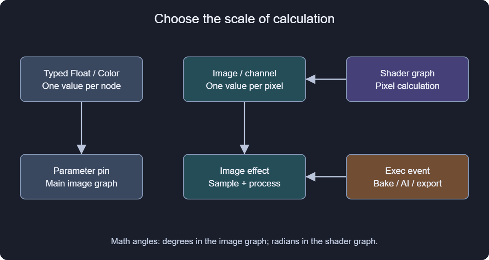

# Complete built-in node reference

This index covers every registered node operation in the shipped build. Use the Nodes search category to restrict results. F1 on a selected main-graph node or selected shader operation opens its matching reference; custom library effects and functions retain their own references.

## Choose the correct graph

- Main image graph: full images/channels, typed values, variables, arrays and explicit execution. Math Sin/Cos use degrees.
- Effect Editor: per-pixel scalar/vector math, image sampling and effect/blend/brush outputs. Shader trigonometry and UV rotation use radians.
- Recorded actions: a sequence of editor commands managed by Action Editor, separate from graph Exec links.

A green scalar image channel contains one number per pixel. A Float pin contains one typed value for the whole calculation. Converting the two graph systems into each other is not implicit. UV coordinates are data until an image is sampled at them.

## Read a reference

Each operation has a stable identifier, purpose, ordered inputs, defaults, outputs and limits. The data snapshot is exported from compiled registries on both GPU backends and tied to the corresponding source versions. Contextual shader defaults such as current UV or brush hardness are labeled as such rather than displayed as negative sentinel values.

Bare structural nodes have dynamic interfaces: an effect gets its pins from shader metadata, a function from its inner ports, and a variable from its declared type. The instantiated Properties panel is authoritative for that node's current configuration.

## Troubleshoot connections

1. Confirm the editor: an image effect belongs in the image graph, arithmetic inside a shader belongs in Effect Editor.
2. Inspect the pin type and array state. A Texture handle only connects to a Texture pin in shader HLSL; it is not an RGBA value.
3. Choose the intended output: RGBA/RGB and individual channels differ, and execution actions often put Result after Exec.
4. Check disconnected defaults and expose important controls explicitly.
5. Connect image output for a visible result and run an event only when retained work or file output is intended.

[Main image graph](#image_graph)
[Shader authoring](#shader_authoring)
[Recorded actions](#actions)
