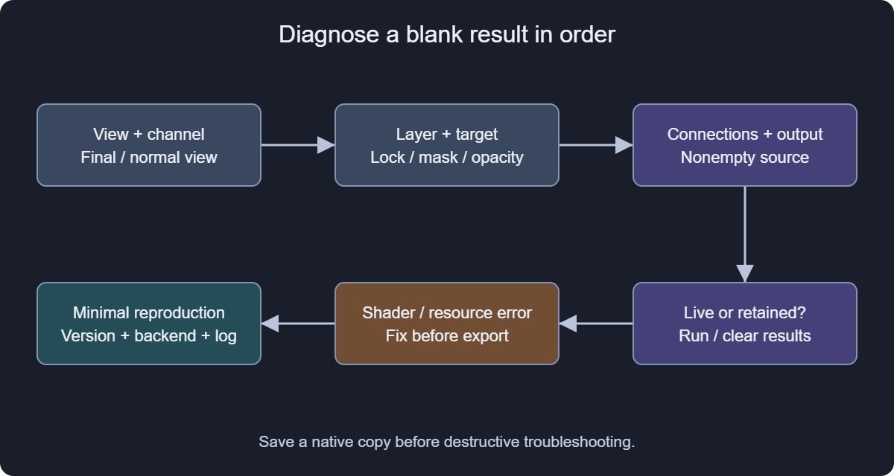

# Diagnose, recover and manage performance

Start with the smallest check that distinguishes the likely causes. Preserve the editable file before destructive experiments. Undo, snapshots, exported images and saved native versions serve different purposes.

## Empty or unexpected image

1. Select Final Image view, a normal display overlay and the intended material channel.
2. Inspect visibility, opacity, blend, Blend If, clipping, masks and the canvas bounds.
3. In Node mode, follow the selected output back to a nonempty image. Check multi-output ports and optional inputs.
4. Distinguish a .sxfn node resource from a complete .sxl example. A pixel surface in a pixel-free function starts empty.
5. A tool can show its live input before execution. Run its event to obtain a retained result, then rerun after upstream edits or clear stored results to return to live data.

## Nothing paints or transforms

Check the unlocked target and its image/mask thumbnail, selection, foreground color, brush opacity/flow and current view. Convert procedural content to pixels or paint on a new pixel layer. A shape's geometry dimensions, a layer's transformed bounds and canvas dimensions are separate. Decimal pixel fields can be entered manually; image dimensions eventually require integral raster sizes.

If pressure is constant, check the tablet backend and driver, then test a brush that actually uses pressure. A mouse does not supply every pen channel. If a numeric control seems inert, it may be disabled by Auto, an active link or the current document mode.

## Shader compilation or missing resources

Open Edit > Shader Errors and inspect shaderixel.log. Check the failing stable shader ID, parameter types, source syntax and image input count. Reloading a renamed file does not repair references to its previous ID. A function that works on another machine may depend on a user library effect or external texture.

For tile seams, check neighbor support, UV sampling and halo metadata. For dark alpha edges, check premultiplication conventions. For strange UV/SDF values, use float precision and avoid color-transfer conversions or unintended clamping. Compile errors must be fixed before comparing a preview to final output.

## Memory and slow work

Pixel storage grows with width × height × channels × bytes per component, multiplied by layers, masks, intermediates and retained results. Doubling each dimension uses roughly four times as many pixels. GPU history also competes for VRAM.

Reduce preview size, expensive blur/sampling radii, brush size/dab density, render samples or simulation resolution while tuning. Keep the final quality requirements for export. Large-image tiled rendering limits some working allocations but does not make every arbitrary full-image shader cheap. Use History memory Auto or sensible budgets; lowering them can forget older edits.

Clear obsolete retained results if live recomputation is wanted. Full-resolution AI/upscale sources may be larger than the graph preview. CPU rendering is an alternative for presentation rendering, not a switch that runs every image shader on the CPU.

## File and environment recovery

- Save a new native version before repacking UVs, merging, flattening or resetting a complex setup.
- If closing/updating prompts about unsaved work, Cancel keeps it open; do not assume a project has been saved merely because an export completed.
- A missing linked asset needs its source restored/relinked or embedded. A layout reset cannot restore missing pixels.
- Close the app before renaming backed-up settings/layout files. Preserve user libraries and project files separately.
- A failed AI request may leave the original live image visible; check endpoint, installed model, API workflow and status rather than exporting that preview as a completed result.

## A useful bug report

Record app version, GPU/backend/driver, document dimensions/precision, exact steps, expected/actual result and relevant log lines. Reduce a copy to the smallest failing graph or layer stack. Include required user effects/functions or a procedural example where possible. Remove credentials and unrelated private files. A screenshot alone may hide the selected output or target, so describe those explicitly.

[Settings and update states](#settings)
[Shader authoring](#shader_authoring)
[Troubleshooting index](#troubleshooting)
